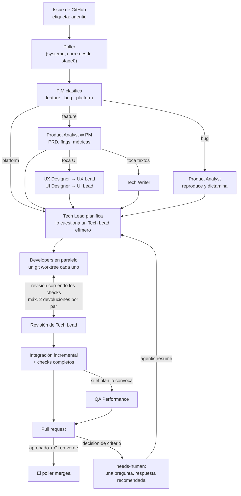

# agentic-system

[English](readme.md) · **Español**

**Un equipo de agentes de IA que lleva un issue de GitHub hasta un pull request mergeado, y que se viene construyendo a sí mismo desde su primera semana.**

[](../pyproject.toml)
[](https://github.com/langchain-ai/langgraph)
[](https://github.com/anthropics/claude-agent-sdk-python)
[](../observability/README.md)
[](../LICENSE)

Abro un issue y le pongo la etiqueta `agentic`. Un poller lo levanta, un agente Project
Manager lo clasifica, los roles de producto y diseño lo definen, un Tech Lead lo planifica,
los Developers lo construyen en paralelo, el Tech Lead revisa corriendo los checks, y el
sistema abre el pull request. Si el Tech Lead lo aprobó y los checks están en verde, el
sistema lo mergea. Si hace falta una decisión mía, frena y me deja una sola pregunta en el
issue.

Este repo es el sistema. Y es también su propio segundo producto: de los 440 pull requests
mergeados acá, 413 los abrió el sistema, un issue a la vez, corriendo desde un clon aparte
que nunca toca.

---

## En números

Calculados el **2026-11-19** con git y la API REST de GitHub. Cómo saqué cada uno está al
final de esta sección.

| | agentic-system (este repo) | [apostrophe](https://github.com/GonzaloZevallos/apostrophe) |
|---|---:|---:|
| Pull requests mergeados | 440 | 344 |
| ...de esos, abiertos por el sistema desde ramas de tarea `agentic/*` | **413** | **329** |
| Issues cerrados | 458 (de 557 abiertos) | 397 (de 527 abiertos) |
| Primer commit / repo creado | 2026-09-12 | 2026-10-02 |

**742 pull requests** escritos, revisados y abiertos por el sistema en dos productos, en
unas diez semanas.

Este repo solo:

| | |
|---|---:|
| Commits en `master` | 3.314 |
| Architecture Decision Records | 104 ADRs del sistema + 1 de módulo |
| Python en `agentic/` (sin el submódulo de skills de terceros) | 285 archivos, ~93.800 líneas |
| Python en `tests/` | 594 archivos, ~192.400 líneas |
| Funciones de test (`def test_*`) | 11.582 |
| Prompts de rol (`agentic/core/process/domain/prompts/`) | 39 |
| Reglas mías que los agentes aplican en vez de preguntarme ([`docs/decisiones-del-dueño.md`](../docs/decisiones-del-dueño.md)) | 21 (2 reemplazadas) |

<details>
<summary>Cómo los calculé</summary>

- Pull requests: `gh api --paginate repos/GonzaloZevallos/<repo>/pulls?state=all`, contando
  los que tienen `merged_at`, y de esos los que tienen `head.ref` empezando con `agentic/`
  (la rama que el sistema crea por tarea, ADR-0011).
- Issues: API de búsqueda de GitHub, `repo:<repo> is:issue is:closed` e `is:issue`.
- Commits, ADRs, archivos y líneas: `git rev-list --count HEAD`, `git ls-files` y `wc -l`
  sobre `master` en `dda52e7c`, dejando afuera `agentic/plugins/` (un submódulo de terceros
  fijado a un sha).
- Funciones de test: `grep` de `def test_` sobre `tests/`. Los casos parametrizados no se
  expanden, así que pytest junta más que esto.
- El gasto en modelos no está a propósito: no tengo un número que se pueda reproducir solo
  con el repo.

</details>

---

## Cómo fluye una tarea



El grafo de roles completo, generado desde el grafo compilado de LangGraph, está en
[`docs/architecture/generated/role-graph.md`](../docs/architecture/generated/role-graph.md).
El paso a paso, con cada afirmación apuntando al archivo y la función que la respaldan, está
en [`docs/architecture/flujos/de-issue-a-merge.md`](../docs/architecture/flujos/de-issue-a-merge.md).

El [diseño](../README.md) describe 19 roles agénticos más el humano. Hoy corren 12: PjM, Reflector, PM,
Product Analyst, UX Designer, UX Lead, UI Designer, UI Lead, Tech Writer, Tech Lead,
Developer y QA Performance. Data Analyst, QA Lead con QA funcional y de seguridad, SRE y
Customer Insights están diseñados pero todavía no construidos.

---

## Por qué lo armé

Construir con agentes suele ser una persona haciendo de PM, Tech Lead, Developer y reviewer
en serie, a la velocidad a la que tipea una persona. Quería darle cada uno de esos roles a un
agente y quedarme solo con lo que tiene que seguir siendo humano: las decisiones que cambian
plata o alcance, y qué significa "bien hecho". ([`BRIEF.md`](../BRIEF.md))

El segundo objetivo era poder medirlo. Un cambio de prompt tiene que demostrar que sirvió, si
no es deriva. Por eso hay un set de evaluación fijo, un puntaje binario y trazas de cada
corrida.

---

## Las ideas que lo hicieron andar

**Nunca escribe en el checkout desde el que corre.** El sistema se desarrolla a sí mismo, así
que un Developer podría cambiar el código de ruteo de la misma corrida que lo está cambiando.
Las corridas se ejecutan desde `stage0`, un clon aparte fijado a un sha. El chequeo es por
repositorio, no por ruta: dos worktrees comparten `.git`, así que `preflight` compara el
`--git-common-dir` y se niega a correr sobre su propio repo. ([ADR-0002](../docs/adr/0002-repos-separados.md), [ADR-0017](../docs/adr/0017-el-sistema-es-su-propio-segundo-producto.md), [`scripts/stage0.sh`](../scripts/stage0.sh))

**Cada validador trae una fuente que el pensador no tuvo.** Un validador con el mismo modelo,
el mismo prompt y la misma información ratifica, no valida. Los pensadores corren en Sonnet,
los validadores en Opus, y el Tech Lead revisa corriendo los checks del producto en el
worktree del Developer, no leyendo el diff. Los hallazgos vienen con evidencia. ([ADR-0016](../docs/adr/0016-el-revisor-verifica-ejecutando.md), diseño §10)

**Los loops se cuentan por par, y se terminan.** Cada par validador→pensador tiene 2
devoluciones. Un Developer que llega al límite tiene un reinicio limpio con el brief
reescrito; después de eso, escala. Un rol que se rompe (JSON inválido, sin turnos) tiene un
reintento con el error, y después escala. Nada de ping-pong infinito. (diseño §3, [ADR-0092](../docs/adr/0092-reinicio-limpio-y-causas-mecanicas.md))

**A mí solo me llegan decisiones de criterio.** Las fallas mecánicas (red, un tropiezo de
GitHub, CI sin veredicto, un choque de número de ADR) se reintentan solas, hasta 3 veces. Las
de criterio me llegan como etiqueta `needs-human` y un solo comentario: una pregunta, la
respuesta recomendada y cada opción como un comando del CLI. Cuando contesto con una regla
general, va a [`docs/decisiones-del-dueño.md`](../docs/decisiones-del-dueño.md), todos los roles
la leen, y la misma pregunta no vuelve.

**Las tareas tienen presupuesto de tamaño, y las grandes se parten.** Un plan declara como
mucho 15 archivos escritos a mano que no sean tests y 400 líneas a mano que no sean tests
(los tests tienen su propio tope de 600 líneas). Lo generado no cuenta. Una parte que sigue
pasada se vuelve a partir, hasta profundidad 2. Cada parte se mergea sola y deja `master` en
verde. ([ADR-0093](../docs/adr/0093-presupuesto-de-tamano-en-codigo-escrito-a-mano-y-las-partes-se-parten-de-nuevo.md))

**El sistema mergea, y aterriza sus propios pull requests.** El poller mergea solo lo que el
Tech Lead aprobó y el CI dejó en verde sobre la cabeza mergeada con el `master` actual. Si el
merge se rechaza, un paso de aterrizaje diagnostica por qué y sincroniza o arregla el mismo
pull request en vez de arrancar de cero. ([ADR-0045](../docs/adr/0045-el-poller-mergea-solo-lo-aprobado-y-verde.md), [ADR-0048](../docs/adr/0048-el-sistema-aterriza-sus-propios-pull-requests.md))

**Un documento por tarea, estado durable.** Los roles se pasan el trabajo por un único
documento Markdown con secciones fijas, no por chat. El estado de LangGraph vive en un
checkpointer SQLite, así que una corrida pausada o caída sigue donde quedó. El poller retoma
las corridas caídas con un calendario y nunca retoma una que frené a propósito. ([ADR-0003](../docs/adr/0003-interrupt-para-escalados.md), diseño §3)

**Los roles aprenden de sus devoluciones.** Cuando cierra una tarea, un Reflector lee por qué
le devolvieron trabajo a cada rol y propone lecciones para el playbook de ese rol. Las cura
código. ([ADR-0043](../docs/adr/0043-los-roles-aprenden-de-sus-devoluciones-con-un-playbook-por-rol.md), [`.agentic/playbooks/`](../.agentic/playbooks))

**Todo queda trazado.** Claude Code exporta OpenTelemetry nativo; un collector lo reenvía a
un Langfuse local. Una tarea es un trace con cada rol como span anidado, con costo, modelo,
versión de la entrega y resultado, más la versión del sistema y el producto. ([ADR-0037](../docs/adr/0037-langfuse-unico-destino-el-dashboard-queda-en-los-documentos.md), [`observability/`](../observability/README.md))

**Hexagonal, con núcleo funcional.** Tres contextos bajo `agentic/core/` (proceso,
conocimiento de producto y medición), cada uno con su glosario. El ruteo y las reglas son
funciones puras en `domain/`; LangGraph, GitHub, git y el SDK son adaptadores detrás de
puertos. ([ADR-0007](../docs/adr/0007-arquitectura-hexagonal.md), [ADR-0010](../docs/adr/0010-modulos-en-core.md), [`CONTEXT-MAP.md`](../CONTEXT-MAP.md))

---

## Lo difícil

- **Lo lento son los checks, no el modelo.** En apostrophe, correr todos los checks sobre el
  árbol entero eran ~2.560 tests y ~7,5 minutos en serie para un cambio de un archivo de CSS,
  y el e2e llegaba al timeout en 17 de 60 tareas. Ahora la puerta de entrega corre solo los
  tests que el cambio puede alcanzar, por clausura de imports ([ADR-0046](../docs/adr/0046-los-chequeos-pueden-correr-solo-lo-que-el-cambio-afecta.md), [ADR-0047](../docs/adr/0047-las-pruebas-de-este-repo-corren-solo-lo-que-el-cambio-alcanza.md)); la suite completa corre una vez por tarea.
- **Los agentes re-deciden lo que ya estaba decidido.** Si lo dejás solo, un rol que no está
  de acuerdo con un ADR o con un plan se desvía callado. Acá tiene que escalar, y para PM un
  ADR cierra la pregunta en vez de llegarme a mí.
- **Auto-hospedarse muerde.** Una corrida que edita el código que la ejecuta le arruina sus
  propias trazas. stage0 existe por eso.
- **Medir un cambio de prompt en serio sale caro.** El puntaje es binario: el diff pasa los
  tests y se mergea sin tocar, o no cuenta. Re-correr cinco tareas por cada ajuste cuesta
  demasiado, así que el set completo corre solo en hitos.

---

## Hecho con esto

**[apostrophe](https://github.com/GonzaloZevallos/apostrophe)** es un back office para un
negocio chico que vende productos por unidad y por peso: precios, ventas, stock, plata que te
deben, gastos y resultados, con varios negocios en una misma instalación sin que se mezclen. Backend en Python, front web en
TypeScript. Yo escribí el brief y contesté los escalados; el código lo escribió el sistema:
329 de sus 344 pull requests mergeados salieron de ramas de tarea `agentic/*`. También es la
base del set de evaluación.

---

## Stack

| | |
|---|---|
| Orquestación | Grafo de [LangGraph](https://github.com/langchain-ai/langgraph) con subgrafos, fan-out y checkpointer SQLite |
| Harness de agentes | [Claude Agent SDK](https://github.com/anthropics/claude-agent-sdk-python): Sonnet para pensadores y sub-agentes, Opus para validadores |
| Lenguaje | Python 3.13, salidas estructuradas con Pydantic, [uv](https://docs.astral.sh/uv/) |
| Calidad | pytest, ruff, mypy (estricto sobre un alcance que crece, [ADR-0021](../docs/adr/0021-el-sistema-se-tipa-a-si-mismo-con-alcance-en-la-configuracion.md)), GitHub Actions |
| Tracker | Issues y pull requests de GitHub vía `gh` |
| Aislamiento | Un git worktree por subtarea, un clon `stage0` fijado por poller |
| Observabilidad | OpenTelemetry → collector → Langfuse local |
| Runtime | Servicios de usuario de systemd para los pollers |

---

## Cómo correrlo

Necesitás Python 3.13, [uv](https://docs.astral.sh/uv/), `git`, [`gh`](https://cli.github.com/)
autenticado y Claude Code / el Claude Agent SDK. Un producto es cualquier repo con un
`.agentic/stack.yaml` que declare sus checks ([referencia](../docs/reference/stack-yaml.md)).

```sh
uv sync --locked
uv run pytest -m "not llm"          # la suite rápida que corre el CI

# Una tarea, desde un issue de GitHub del repo del producto
uv run agentic run --issue 123 --product-dir /ruta/al/producto

# Una tarea pausada: contestás en el issue y después
uv run agentic resume --issue 123 --product-dir /ruta/al/producto
```

Para que trabaje solo, creá un clon stage0 e instalá un poller desde ahí:

```sh
scripts/stage0.sh origin/master                  # clon fijado a un sha, ~/.agentic-stage0
scripts/install-poller.sh /ruta/al/producto      # unidad de usuario de systemd
```

Todos los comandos están en la [referencia del CLI](../docs/reference/cli.md).

---

## Mapa del repo

```
agentic/
  cli.py, composition.py     punto de entrada y cableado
  core/process/              roles, tarea, reglas de ruteo, el grafo de LangGraph (el dominio central)
  core/knowledge/            conocimiento de producto: definiciones, ADRs, glosarios, el stack
  core/measurement/          métricas, evaluación, spans de OpenTelemetry, scores de Langfuse
  shared/                    configuración
tests/                       tests unitarios, de contrato y de conformidad (los llm son opt-in)
scripts/                     stage0, instalación del poller, selector de tests afectados, generador de docs
observability/               collector y setup de Langfuse
README.md                    el documento de diseño completo, la fuente que siguen los agentes
docs/
  adr/                       104 architecture decision records
  architecture/              páginas C4, flujos clave y diagramas generados
  reference/                 referencia generada del CLI y de stack.yaml
.agentic/                    este repo como producto: stack, playbooks, documentos de tarea
```

Arrancá por el [documento de diseño completo](../README.md) y por
[`docs/adr/`](../docs/adr) para las decisiones con trade-offs reales. Los dos están en
castellano; el código, los prompts y los issues, en inglés.

---

## Sobre mí

Soy Gonzalo Zevallos ([@GonzaloZevallos](https://github.com/GonzaloZevallos)). Diseñé este
sistema y lo manejo yo: decido qué se construye, contesto los escalados y pongo las reglas.
El código lo escriben los agentes.

Estoy abierto a roles en IA / agentic engineering.

---

[MIT](../LICENSE) © 2026 Gonzalo Zevallos
