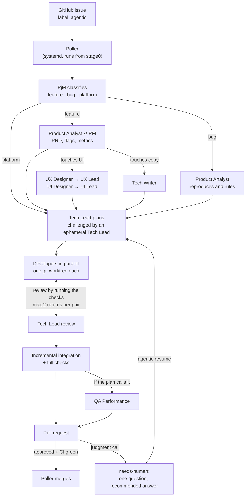

# agentic-system

**English** · [Español](README.es.md)

**A team of AI agents that takes a GitHub issue to a merged pull request, and that has been building itself since its first week.**

[](../pyproject.toml)
[](https://github.com/langchain-ai/langgraph)
[](https://github.com/anthropics/claude-agent-sdk-python)
[](../observability/README.md)
[](../LICENSE)

I open an issue and put the `agentic` label on it. A poller picks it up, a Project Manager
agent classifies it, product and design roles define it, a Tech Lead plans it, Developers
build it in parallel, the Tech Lead reviews by running the checks, and the system opens the
pull request. If the Tech Lead approved it and the checks are green, the system merges it.
If something needs a human call, it stops and asks me one question on the issue.

This repo is the system. It is also its own second product: 413 of the 440 pull requests
merged here were opened by the system, one issue at a time, running from a separate clone it
never edits.

---

## By the numbers

Computed on **2026-11-19** from git and the GitHub REST API. How each one was computed is
at the end of this section.

| | agentic-system (this repo) | [apostrophe](https://github.com/GonzaloZevallos/apostrophe) |
|---|---:|---:|
| Pull requests merged | 440 | 344 |
| ...of those, opened by the system from `agentic/*` task branches | **413** | **329** |
| Issues closed | 458 (of 557 opened) | 397 (of 527 opened) |
| First commit / repo created | 2026-09-12 | 2026-10-02 |

**742 pull requests** written, reviewed and opened by the system across two products in
about ten weeks.

This repo on its own:

| | |
|---|---:|
| Commits on `master` | 3,314 |
| Architecture Decision Records | 104 system ADRs + 1 module ADR |
| Python in `agentic/` (excluding the vendored skills submodule) | 285 files, ~93,800 lines |
| Python in `tests/` | 594 files, ~192,400 lines |
| Test functions (`def test_*`) | 11,582 |
| Role prompts (`agentic/core/process/domain/prompts/`) | 39 |
| Owner rules the agents apply instead of asking me ([`docs/decisiones-del-dueño.md`](../docs/decisiones-del-dueño.md)) | 21 (2 superseded) |

<details>
<summary>How these were computed</summary>

- Pull requests: `gh api --paginate repos/GonzaloZevallos/<repo>/pulls?state=all`, counting
  `merged_at != null`, and of those the ones whose `head.ref` starts with `agentic/` (the
  branch the system creates per task, ADR-0011).
- Issues: GitHub search API, `repo:<repo> is:issue is:closed` and `is:issue`.
- Commits, ADRs, files and lines: `git rev-list --count HEAD`, `git ls-files` and `wc -l`
  on `master` at `dda52e7c`, with `agentic/plugins/` (a pinned third-party submodule) left out.
- Test functions: `grep` for `def test_` over `tests/`. Parametrized cases are not expanded,
  so pytest collects more than this.
- Model spend is not here on purpose: I don't have a number I can reproduce from the repo alone.

</details>

---

## How a task flows



The full role graph, generated from the compiled LangGraph graph, is in
[`docs/architecture/generated/role-graph.md`](../docs/architecture/generated/role-graph.md).
The step-by-step sequence, with every claim pointing at the file and function behind it, is in
[`docs/architecture/flujos/de-issue-a-merge.md`](../docs/architecture/flujos/de-issue-a-merge.md) (Spanish).

The [design](../README.md) describes 19 agentic roles plus the human. 12 of them run today: PjM, Reflector,
PM, Product Analyst, UX Designer, UX Lead, UI Designer, UI Lead, Tech Writer, Tech Lead,
Developer and QA Performance. Data Analyst, the QA Lead with functional and security QA, SRE
and Customer Insights are designed and not built yet.

---

## Why I built it

Building with agents usually means one person doing PM, Tech Lead, Developer and reviewer in
series, at the speed one person types. I wanted to hand each of those roles to an agent and
keep only what has to stay human: calls that trade money or scope, and the decision of what
"good" means. ([`BRIEF.md`](../BRIEF.md))

The second goal was to make it measurable. A prompt change has to prove it helped, or it is
drift. That is why there is a fixed evaluation set, a binary score and traces for every run.

---

## The ideas that made it work

**It never writes the checkout it runs from.** The system develops itself, so a Developer
could change the routing code of the very run that is changing it. Runs execute from
`stage0`, a separate clone pinned to a sha. The check is by repository, not by path: two
worktrees share `.git`, so `preflight` compares `--git-common-dir` and refuses to run on its
own repo. ([ADR-0002](../docs/adr/0002-repos-separados.md), [ADR-0017](../docs/adr/0017-el-sistema-es-su-propio-segundo-producto.md), [`scripts/stage0.sh`](../scripts/stage0.sh))

**Every validator brings a source the thinker didn't have.** A validator with the same model,
prompt and information ratifies, it doesn't validate. Thinkers run on Sonnet, validators on
Opus, and the Tech Lead reviews by running the product's own checks in the Developer's
worktree, not by reading the diff. Findings come with evidence. ([ADR-0016](../docs/adr/0016-el-revisor-verifica-ejecutando.md), design §10)

**Loops are counted per pair, and they end.** Each validator→thinker pair gets 2 returns. A
Developer that hits the limit gets one clean restart with a rewritten brief; after that it
escalates. A role that breaks (invalid JSON, out of turns) gets one retry with the error, then
escalates. No infinite ping-pong. (design §3, [ADR-0092](../docs/adr/0092-reinicio-limpio-y-causas-mecanicas.md))

**I only get asked judgment calls.** Mechanical failures (network, GitHub hiccups, CI with no
verdict, an ADR number collision) are retried on their own, up to 3 times. Judgment calls go
to me as a `needs-human` label and one comment: one question, the recommended answer, and
each option as a CLI command. When I answer with a general rule, it goes into
[`docs/decisiones-del-dueño.md`](../docs/decisiones-del-dueño.md) and every role reads it, so the
same question doesn't come back.

**Tasks have a size budget, and big ones split.** A plan declares at most 15 hand-written
non-test files and 400 hand-written non-test lines (tests have their own 600-line cap).
Generated files don't count. A part still over budget splits again, up to depth 2. Each part
merges alone and leaves `master` green. ([ADR-0093](../docs/adr/0093-presupuesto-de-tamano-en-codigo-escrito-a-mano-y-las-partes-se-parten-de-nuevo.md))

**The system merges, and lands its own pull requests.** The poller merges only what the
Tech Lead approved and CI left green on the head merged with current `master`. If the merge
is refused, a landing step diagnoses why and syncs or fixes the same pull request instead of
starting over. ([ADR-0045](../docs/adr/0045-el-poller-mergea-solo-lo-aprobado-y-verde.md), [ADR-0048](../docs/adr/0048-el-sistema-aterriza-sus-propios-pull-requests.md))

**One document per task, durable state.** Roles hand off through one Markdown document with
fixed sections, not chat. The LangGraph state lives in a SQLite checkpointer, so a paused or
crashed run resumes where it stopped. The poller retakes crashed runs on a schedule and never
retakes one I stopped on purpose. ([ADR-0003](../docs/adr/0003-interrupt-para-escalados.md), design §3)

**Roles learn from their returns.** After a task closes, a Reflector reads why each role got
work sent back and proposes lessons for that role's playbook. Code curates them. ([ADR-0043](../docs/adr/0043-los-roles-aprenden-de-sus-devoluciones-con-un-playbook-por-rol.md), [`.agentic/playbooks/`](../.agentic/playbooks))

**Everything is traced.** Claude Code exports OpenTelemetry natively; a collector forwards it
to a local Langfuse. A task is one trace with each role as a nested span, stamped with cost,
model, delivery version and outcome, plus the system version and the product. ([ADR-0037](../docs/adr/0037-langfuse-unico-destino-el-dashboard-queda-en-los-documentos.md), [`observability/`](../observability/README.md))

**Hexagonal, functional core.** Three bounded contexts under `agentic/core/` (process,
product knowledge, measurement), each with its own glossary. Routing and rules are pure
functions in `domain/`; LangGraph, GitHub, git and the SDK are adapters behind ports. ([ADR-0007](../docs/adr/0007-arquitectura-hexagonal.md), [ADR-0010](../docs/adr/0010-modulos-en-core.md), [`CONTEXT-MAP.md`](../CONTEXT-MAP.md))

---

## What's hard

- **Checks, not the model, are the slow part.** On apostrophe, every check over the whole
  tree was ~2,560 tests and ~7.5 minutes in series for a one-file CSS change, and e2e hit the
  timeout in 17 of 60 tasks. Now the delivery gate runs only the tests the change can reach, picked by import closure ([ADR-0046](../docs/adr/0046-los-chequeos-pueden-correr-solo-lo-que-el-cambio-afecta.md), [ADR-0047](../docs/adr/0047-las-pruebas-de-este-repo-corren-solo-lo-que-el-cambio-alcanza.md)); the full suite runs once per task.
- **Agents re-decide what was already decided.** Left alone, a role that disagrees with an ADR
  or a plan quietly diverges. Here it has to escalate, and an ADR closes the question for PM
  instead of going to me.
- **Self-hosting bites.** A run that edits the code running it poisons its own traces. stage0
  exists because of that.
- **Measuring a prompt change honestly is expensive.** The score is binary: the diff passes
  the tests and gets merged untouched, or it doesn't count. Re-running five tasks for every
  tweak costs too much, so the full set only runs on milestones.

---

## Built with it

**[apostrophe](https://github.com/GonzaloZevallos/apostrophe)** is a back office for a small
business that sells products by unit and by weight: prices, sales, stock, money owed,
expenses and results, with several businesses in one install that never mix. Python backend, TypeScript web front. I wrote the brief and answered
escalations; the system wrote the code: 329 of its 344 merged pull requests came from
`agentic/*` task branches. It is also the base of the evaluation set.

---

## Tech stack

| | |
|---|---|
| Orchestration | [LangGraph](https://github.com/langchain-ai/langgraph) graph with subgraphs, fan-out and a SQLite checkpointer |
| Agent harness | [Claude Agent SDK](https://github.com/anthropics/claude-agent-sdk-python): Sonnet for thinkers and sub-agents, Opus for validators |
| Language | Python 3.13, Pydantic structured outputs, [uv](https://docs.astral.sh/uv/) |
| Quality | pytest, ruff, mypy (strict on a growing scope, [ADR-0021](../docs/adr/0021-el-sistema-se-tipa-a-si-mismo-con-alcance-en-la-configuracion.md)), GitHub Actions |
| Tracker | GitHub issues and pull requests through `gh` |
| Isolation | git worktrees per subtask, a pinned `stage0` clone per poller |
| Observability | OpenTelemetry → collector → local Langfuse |
| Runtime | systemd user services for the pollers |

---

## Running it

You need Python 3.13, [uv](https://docs.astral.sh/uv/), `git`, an authenticated
[`gh`](https://cli.github.com/) and Claude Code / the Claude Agent SDK. A product is any repo
with a `.agentic/stack.yaml` that declares its checks ([reference](../docs/reference/stack-yaml.md)).

```sh
uv sync --locked
uv run pytest -m "not llm"          # the fast suite CI runs

# One task, from a GitHub issue of the product repo
uv run agentic run --issue 123 --product-dir /path/to/product

# A paused task: answer on the issue, then
uv run agentic resume --issue 123 --product-dir /path/to/product
```

To let it work on its own, create a stage0 clone and install a poller from it:

```sh
scripts/stage0.sh origin/master                  # clone pinned to a sha, ~/.agentic-stage0
scripts/install-poller.sh /path/to/product       # systemd user unit
```

Every command is in the [CLI reference](../docs/reference/cli.md).

---

## Repo map

```
agentic/
  cli.py, composition.py     entry point and wiring
  core/process/              roles, task, routing rules, the LangGraph graph (the core domain)
  core/knowledge/            product knowledge: definitions, ADRs, glossaries, the stack
  core/measurement/          metrics, evaluation, OpenTelemetry spans, Langfuse scores
  shared/                    configuration
tests/                       unit, contract and conformance tests (llm tests are opt-in)
scripts/                     stage0, poller install, affected-tests selector, docs generator
observability/               collector and Langfuse setup
README.md                    the full design document (Spanish), the source the agents follow
docs/
  adr/                       104 architecture decision records
  architecture/              C4 pages, key flows and generated diagrams
  reference/                 generated CLI and stack.yaml reference
.agentic/                    this repo as a product: stack, playbooks, task documents
```

Start with the [full design doc](../README.md) for the whole design and
[`docs/adr/`](../docs/adr) for the decisions with real trade-offs. Both are in Spanish; code,
prompts and issues are in English.

---

## About the author

I'm Gonzalo Zevallos ([@GonzaloZevallos](https://github.com/GonzaloZevallos)). I designed this
system and I run it: I set what gets built, answer the escalations and decide the rules. The
agents write the code.

Open to roles in AI / agentic engineering.

---

[MIT](../LICENSE) © 2026 Gonzalo Zevallos
