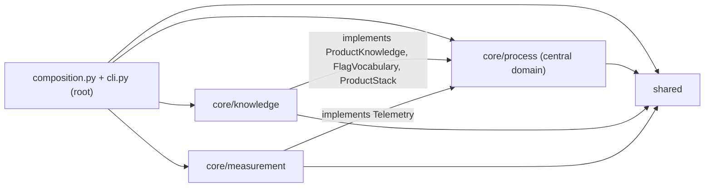

# Componentes

Los tres módulos de `agentic/core/`, el código compartido y la raíz que los une. Cada módulo
es hexagonal por dentro (ADR-0007): dominio, aplicación y adaptadores; y la dirección entre
módulos es fija (ADR-0010). Un test sobre los imports vigila las dos reglas
(`tests/test_architecture.py`). El mapa de contextos con su glosario está en
[CONTEXT-MAP.md](../../CONTEXT-MAP.md).

`core/process` no importa a los otros dos: declara en sus puertos lo que necesita del
conocimiento y del tracing, y ellos lo implementan. Solo
`agentic/composition.py:default_ports` los conoce a todos y los cablea.

## `shared`

Configuración y entorno, sin importar nada del proyecto:
`agentic/shared/configuration.py:Configuration` (qué se lee de `AGENTIC_*` y de cada
producto), `agentic/shared/environment.py:own_configuration_unset` (el entorno que se le pasa
a lo que se spawnea, sin la configuración propia) y `agentic/shared/stage0.py:CHECKOUT`
(dónde está el checkout que ejecuta).

## `core/process`

Es el dominio central: los roles, la tarea y su documento, el camino y sus reglas. El
vocabulario está en `agentic/core/process/CONTEXT.md`.

- `domain/`: funciones puras sobre `TaskState`, sin clase agregado (ADR-0009). Las reglas de
  ruteo, de tope y de reanudación viven en `agentic/core/process/domain/rules.py`, y la tabla
  del aterrizaje en `agentic/core/process/domain/landing.py:landing_step`.
- `application/`: un caso de uso por nodo (`classify`, `define`, `plan`, `develop`, `review`,
  `integrate`, `deliver`, `escalate`...), más `poll`, `landing`, `merge` y `resume`. Reciben
  `Configuration` y `Ports`.
- `adapters/`: implementan los puertos. `langgraph/` arma el grafo
  (`agentic/core/process/adapters/langgraph/graph.py:build_graph`); `claude_sdk/`, `git/`,
  `github/`, `shell/` y `filesystem/` hablan con el mundo.

Los puertos están en `agentic/core/process/application/ports.py`, agrupados en el
dataclass `Ports` (`agentic/core/process/application/ports.py:Ports`):

| Puerto | Qué pide | Adaptador real |
|---|---|---|
| `RoleRunner` | correr un rol y devolver su resultado | `agentic/core/process/adapters/claude_sdk/runner.py:ClaudeSdkRunner` |
| `TaskDocuments` | leer y escribir el documento de la tarea | `agentic/core/process/adapters/filesystem/documents.py:FilesystemTaskDocuments` |
| `Prompts` | el prompt de cada rol, con overlay del producto | `agentic/core/process/adapters/filesystem/prompts.py:FilesystemPrompts` |
| `Workspace` | ramas, worktrees, commits y upstream | `agentic/core/process/adapters/git/workspace.py:GitWorkspace` |
| `Tracker` | pull requests, comentarios y etiquetas | `agentic/core/process/adapters/github/tracker.py:GhTracker` |
| `Inbox` | la cola de issues | `agentic/core/process/adapters/github/inbox.py:GhInbox` |
| `Board` | el espejo del Project | `agentic/core/process/adapters/github/board.py:GhBoard` |
| `Commands` | correr los chequeos del producto | `agentic/core/process/adapters/shell/commands.py:ShellCommands` |
| `ProcessReaper` | matar lo que un intento dejó vivo | `agentic/core/process/adapters/shell/reaper.py:ShellReaper` |
| `CheckScheduler` | repartir los núcleos entre chequeos | `agentic/core/process/adapters/filesystem/check_ledger.py:FilesystemCheckLedger` |
| `PerfRunner`, `PerfLock` | medir y serializar la medición | `agentic/core/process/adapters/shell/perf_runner.py:PerfShellRunner`, `agentic/core/process/adapters/filesystem/perf_lock.py:FilesystemPerfLock` |
| `RunLock`, `RunRegistry` | un solo proceso por tarea, quién corre | `agentic/core/process/adapters/filesystem/lock.py:FilesystemRunLock`, `agentic/core/process/adapters/filesystem/run_registry.py:FilesystemRunRegistry` |
| `Scratch`, `FreeSpace` | el directorio temporal y el espacio libre | `agentic/core/process/adapters/filesystem/scratch.py:FilesystemScratch`, `agentic/core/process/adapters/filesystem/free_space.py:StatvfsFreeSpace` |
| `StopFlag` | marcar que una señal frena la corrida | `agentic/core/process/adapters/shell/stop.py:EventStopFlag` |
| `Telemetry` | abrir el span de cada rol | `agentic/core/measurement/adapters/otel/telemetry.py` (ver abajo) |

`ProductKnowledge`, `FlagVocabulary` y `ProductStack` los implementa `core/knowledge`.

## `core/knowledge`

Lo destilado y vigente sobre el producto. Provee al proceso lo que el proceso le pide
y no lo dirige.

- `domain/`: cómo se muestra y se edita el conocimiento
  (`agentic/core/knowledge/domain/knowledge.py`), el vocabulario de banderas
  (`agentic/core/knowledge/domain/flags.py`) y el stack del producto con sus chequeos
  (`agentic/core/knowledge/domain/stack.py`). Este último define las claves de
  `.agentic/stack.yaml` en `KEYS` y su descripción en `KEY_REFERENCE`, de donde sale la
  [referencia de `stack.yaml`](../reference/stack-yaml.md).
- `adapters/filesystem/`: `FilesystemKnowledge` implementa `ProductKnowledge`
  (`agentic/core/knowledge/adapters/filesystem/knowledge.py:FilesystemKnowledge`) y
  `FilesystemFlags` implementa `FlagVocabulary`
  (`agentic/core/knowledge/adapters/filesystem/flags.py:FilesystemFlags`).
- `adapters/git/`: `GitStack` implementa `ProductStack`, leyendo el stack del commit base
  (`agentic/core/knowledge/adapters/git/stack.py:GitStack`).

## `core/measurement`

Las métricas del sistema sobre las corridas y las trazas que las llevan.

- `domain/`: retrabajo, devoluciones, puntajes y el scorecard
  (`agentic/core/measurement/domain/metrics.py`,
  `agentic/core/measurement/domain/scorecard.py`).
- `application/`: el caso de uso de los dashboards, con sus propios puertos `DashboardStore`
  y `WidgetData` (`agentic/core/measurement/application/dashboards.py`).
- `adapters/otel/`: spans y métricas; el módulo
  `agentic/core/measurement/adapters/otel/telemetry.py` cumple el puerto `Telemetry` de
  proceso y la composición se lo pasa a `build_graph`.
- `adapters/langfuse/`: puntajes (`agentic/core/measurement/adapters/langfuse/scores.py:LangfuseScores`)
  y dashboards (`agentic/core/measurement/adapters/langfuse/dashboards.py:PostgresDashboards`,
  `agentic/core/measurement/adapters/langfuse/widget_data.py:ClickHouseWidgetData`).

## Los diagramas generados

`scripts/docs/generate.py` dibuja los paquetes y las clases públicas de cada módulo con
pyreverse, una vista por módulo y una de clases por capa:

- paquetes (Mermaid puro): [process](generated/packages-process.mmd),
  [knowledge](generated/packages-knowledge.mmd) y
  [measurement](generated/packages-measurement.mmd);
- clases de `process`: [dominio](generated/classes-process-domain.mmd),
  [aplicación](generated/classes-process-application.mmd) y
  [adaptadores](generated/classes-process-adapters.mmd);
- clases de `knowledge`: [dominio](generated/classes-knowledge-domain.mmd) y
  [adaptadores](generated/classes-knowledge-adapters.mmd);
- clases de `measurement`: [dominio](generated/classes-measurement-domain.mmd),
  [aplicación](generated/classes-measurement-application.mmd) y
  [adaptadores](generated/classes-measurement-adapters.mmd).

El grafo de roles está en [role-graph.md](generated/role-graph.md).
