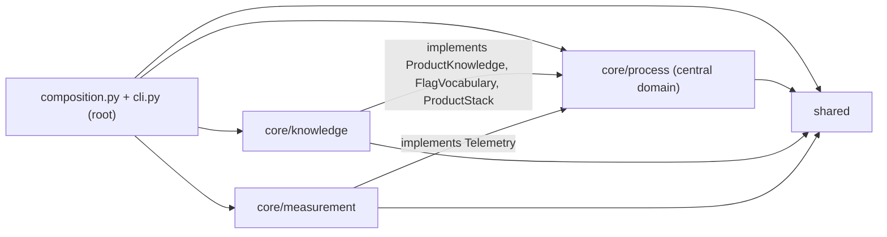

# Componentes

Los tres módulos de `agentic/core/`, el código compartido y la raíz que los une. Cada módulo
es hexagonal por dentro (ADR-0007): dominio, aplicación y adaptadores; y la dirección entre
módulos es fija (ADR-0010). Un test sobre los imports vigila las dos reglas
(`tests/test_architecture.py`). El mapa de contextos con su glosario está en
[CONTEXT-MAP.md](../../CONTEXT-MAP.md).

`core/process` no importa a los otros dos: declara en sus puertos lo que necesita del
conocimiento y del tracing, y ellos lo implementan. Solo
`agentic/composition.py:default_ports` los conoce a todos y los cablea.

## `shared`

Configuración y entorno, sin importar nada del proyecto:
`agentic/shared/configuration.py:Configuration` (qué se lee de `AGENTIC_*` y de cada
producto), `agentic/shared/environment.py:own_configuration_unset` (el entorno que se le pasa
a lo que se spawnea, sin la configuración propia) y `agentic/shared/stage0.py:CHECKOUT`
(dónde está el checkout que ejecuta).

## `core/process`

Es el dominio central: los roles, la tarea y su documento, el camino y sus reglas. El
vocabulario está en `agentic/core/process/CONTEXT.md`.

- `domain/`: funciones puras sobre `TaskState`, sin clase agregado (ADR-0009). Las reglas de
  ruteo, de tope y de reanudación viven en `agentic/core/process/domain/rules.py`, y la tabla
  del aterrizaje en `agentic/core/process/domain/landing.py:landing_step`. La declaración de
  experimento del producto y la asignación de brazo a cada tarea son puras y viven en
  `agentic/core/process/domain/experiment.py`; el brazo asignado llega a la `Configuration` de
  cada nodo por `configuration_from` (`agentic/core/process/adapters/langgraph/graph.py`), que
  lee la asignación del estado (ADR-0081).
- `application/`: un caso de uso por nodo (`classify`, `define`, `plan`, `develop`, `review`,
  `integrate`, `deliver`, `escalate`...), más `poll`, `landing`, `merge` y `resume`. Reciben
  `Configuration` y `Ports`.
- `adapters/`: implementan los puertos. `langgraph/` arma el grafo
  (`agentic/core/process/adapters/langgraph/graph.py:build_graph`); `claude_sdk/`, `git/`,
  `github/`, `shell/` y `filesystem/` hablan con el mundo.

Los puertos están en `agentic/core/process/application/ports.py`, agrupados en el
dataclass `Ports` (`agentic/core/process/application/ports.py:Ports`):

| Puerto | Qué pide | Adaptador real |
|---|---|---|
| `RoleRunner` | correr un rol y devolver su resultado | `agentic/core/process/adapters/claude_sdk/runner.py:ClaudeSdkRunner` |
| `TaskDocuments` | leer y escribir el documento de la tarea | `agentic/core/process/adapters/filesystem/documents.py:FilesystemTaskDocuments` |
| `Prompts` | el prompt de cada rol, con overlay del producto | `agentic/core/process/adapters/filesystem/prompts.py:FilesystemPrompts` |
| `Workspace` | ramas, worktrees, commits y upstream | `agentic/core/process/adapters/git/workspace.py:GitWorkspace` |
| `Tracker` | pull requests, comentarios, etiquetas, reescritura del cuerpo de un issue (`update_issue_body`, GH-619: re-apunta las líneas `Blocked by:` de los dependientes de una partida), lectura del CI y despacho del workflow de la rama base (`dispatch_ci`, `dispatched_ci`, GH-462) | `agentic/core/process/adapters/github/tracker.py:GhTracker` |
| `CiLogs` (opcional, `None` sin adaptador) | los logs de los jobs rojos de la cabeza de un pull request y, para la cabeza que se juzga (`flake_block`, GH-464), las líneas `agentic-flakes:` de los últimos 4 MiB del log de los jobs que nombra el `ci:` del stack | `agentic/core/process/adapters/github/ci_logs.py:GhCiLogs` |
| `ExperimentFile` (opcional, `None` sin adaptador) | la declaración de experimento del producto, el archivo experiment.yaml de .agentic | `agentic/core/process/adapters/filesystem/experiment_file.py:FilesystemExperimentFile` |
| `SpecReader` (opcional, `None` sin adaptador; nadie lo llama aún, GH-594) | leer una spec del repo del producto en un commit completo, nunca del worktree; sólo `docs/specs/<nombre>.md`, un blob de a lo sumo 64 KiB en UTF-8, y si no, `SpecUnreadable` con el motivo y nada más | `agentic/core/knowledge/adapters/git/spec_reader.py:GitSpecReader` |
| `Inbox` | la cola de issues | `agentic/core/process/adapters/github/inbox.py:GhInbox` |
| `Board` | el espejo del Project | `agentic/core/process/adapters/github/board.py:GhBoard` |
| `Commands` | correr los chequeos del producto | `agentic/core/process/adapters/shell/commands.py:ShellCommands` |
| `ProcessReaper` | matar lo que un intento dejó vivo | `agentic/core/process/adapters/shell/reaper.py:ShellReaper` |
| `CheckScheduler` | repartir los núcleos entre chequeos | `agentic/core/process/adapters/filesystem/check_ledger.py:FilesystemCheckLedger` |
| `PerfRunner`, `PerfLock` | medir y serializar la medición | `agentic/core/process/adapters/shell/perf_runner.py:PerfShellRunner`, `agentic/core/process/adapters/filesystem/perf_lock.py:FilesystemPerfLock` |
| `LoadReader` | leer la carga de la máquina (la única lectura de `os.getloadavg`) | `agentic/core/process/adapters/shell/load_reader.py:ShellLoadReader` |
| `RunLock`, `RunRegistry` | un solo proceso por tarea, quién corre; el registro guarda además los intentos de la cola exenta del poller, con clave `(producto, issue, tipo)`, y la espera exenta que publica cada producto (`exempt/attempts/`, `exempt/waiting/`; `FilesystemRunRegistry.exempt_attempts`, `FilesystemRunRegistry.publish_exempt_wait`) | `agentic/core/process/adapters/filesystem/lock.py:FilesystemRunLock`, `agentic/core/process/adapters/filesystem/run_registry.py:FilesystemRunRegistry` |
| `Scratch`, `FreeSpace` | el directorio temporal y el espacio libre | `agentic/core/process/adapters/filesystem/scratch.py:FilesystemScratch`, `agentic/core/process/adapters/filesystem/free_space.py:StatvfsFreeSpace` |
| `StopFlag` | marcar que una señal frena la corrida | `agentic/core/process/adapters/shell/stop.py:EventStopFlag` |

`ProductKnowledge`, `FlagVocabulary` y `ProductStack` los implementa `core/knowledge`.
`Telemetry` no es un campo de `Ports`: es un puerto aparte
(`agentic/core/process/adapters/telemetry.py:Telemetry`) que la composición le pasa a
`build_graph`, y lo cumple `core/measurement` (ver abajo).

`LabelTimeline` tampoco es un campo de `Ports`: es una lectura estrecha, aparte de `Tracker`
(`agentic/core/process/application/ports.py:LabelTimeline`), que la composición le pasa solo
al cierre (`agentic/cli.py:_close_document`) y al merge del sistema
(`agentic/core/process/application/merge.py:merge_task`). Pide la última vez que se agregó una
etiqueta a un issue, y arranca el tiempo de entrega; la cumple
`agentic/core/process/adapters/github/label_timeline.py:GhLabelTimeline`, que ante cualquier
falla devuelve `None`.

Los puertos de la rotación de stage0 (GH-632) tampoco son campos de `Ports`: los recibe
`agentic/core/process/application/stage0_rotate.py:rotate` como parámetros, y nadie lo llama
aún ni hay adaptadores (llegan en partes posteriores). `Stage0Store` es la raíz de rotación
(lock no bloqueante, `current`, `rejected`, `switch.json` como intención que el lector
confirma contra `current()`, `promote` y `switch_current`), `Stage0Users` dice qué stages se
usan, `MasterWindow` lee la ventana de commits de origin/master, `Stage0Candidate` prepara y
prueba un candidato, `Stage0Escalation` escala sin lanzar, y `FailurePolicy` decide qué hacer
ante un fallo del candidato (por defecto conserva `current` y nunca escribe `rejected`); todos
en `agentic/core/process/application/ports.py`.

## `core/knowledge`

Lo destilado y vigente sobre el producto. Provee al proceso lo que el proceso le pide
y no lo dirige.

- `domain/`: cómo se muestra y se edita el conocimiento
  (`agentic/core/knowledge/domain/knowledge.py`), el vocabulario de banderas
  (`agentic/core/knowledge/domain/flags.py`) y el stack del producto con sus chequeos
  (`agentic/core/knowledge/domain/stack.py`). Este último define las claves de
  `.agentic/stack.yaml` en `KEYS` y su descripción en `KEY_REFERENCE`, de donde sale la
  [referencia de `stack.yaml`](../reference/stack-yaml.md). Las decisiones del dueño
  (`agentic/core/knowledge/domain/owner_rules.py`) se leen, se anexan y se vigencian ahí:
  todo rol recibe entera la parte vigente de `decisiones-del-dueño.md`.
- `adapters/filesystem/`: `FilesystemKnowledge` implementa `ProductKnowledge`
  (`agentic/core/knowledge/adapters/filesystem/knowledge.py:FilesystemKnowledge`) y
  `FilesystemFlags` implementa `FlagVocabulary`
  (`agentic/core/knowledge/adapters/filesystem/flags.py:FilesystemFlags`).
- `adapters/git/`: `GitStack` implementa `ProductStack`, leyendo el stack del commit base
  (`agentic/core/knowledge/adapters/git/stack.py:GitStack`); `GitSpecReader` implementa
  `SpecReader`, leyendo una spec de un commit con git de bajo nivel y un entorno limpio
  (`agentic/core/knowledge/adapters/git/spec_reader.py:GitSpecReader`).

## `core/measurement`

Las métricas del sistema sobre las corridas y las trazas que las llevan.

- `domain/`: retrabajo, devoluciones, puntajes y el scorecard
  (`agentic/core/measurement/domain/metrics.py`,
  `agentic/core/measurement/domain/scorecard.py`), y las cifras de tiempo de una tarea, el
  ciclo y el tiempo activo (`agentic/core/measurement/domain/cycle.py`). Si una pausa es externa
  o humana lo decide `rules.pause_kind` (`agentic/core/process/domain/rules.py`), el único
  clasificador, que `cycle` importa como único nombre de `rules`; el scorecard importa también
  `rules.EXTERNAL_REASONS` en vez de tener una lista propia (GH-593). El brazo de una tarea
  se lee por `metrics.arm_of` (su asignación si la tiene, si no su `experiment`, ADR-0081) y, para
  el único interruptor `plan_shape` que el historial de costos necesita, por
  `experiment.plan_shape_of` (ADR-0087).
- `application/`: el caso de uso de los dashboards, con sus propios puertos `DashboardStore`
  y `WidgetData` (`agentic/core/measurement/application/dashboards.py`), y los comandos de
  `eval` (`agentic/core/measurement/application/eval_commands.py`), que `cli.py` envuelve:
  `eval score` y `eval compare` son de solo lectura; `eval run` ya no lo es, es el driver
  de las evaluaciones fijadas a una base (GH-470). Corre cada entrada del eval set una vez por
  brazo en una raíz aislada `<producto>/.agentic/eval/<id>/` con id
  `EVAL-<issue>-<sha8>-<brazo>-<k>`, cuenta cupo, esperas de land y pausa de cuenta dentro de un
  solo `registry.exclusive()` con las funciones de `rules` del poller, lanza el hijo con
  `AGENTIC_PRODUCT_DIR=<raíz>`, y al terminar copia el documento a `.agentic/eval/docs/`,
  borra la raíz y las ramas `agentic/EVAL-*`. Sus puertos propios, en
  `agentic/core/measurement/application/ports.py`: `EvalRoots` (resolver la base, crear,
  listar y quitar raíces y ramas) y `EvalSpawn` (lanzar el hijo, que devuelve un `EvalChild`).
- `adapters/git/`: `agentic/core/measurement/adapters/git/eval_roots.py:GitEvalRoots` cumple
  `EvalRoots` con `git worktree add --detach` en la base de la entrada y su limpieza
  (`worktree remove`, `prune`, `branch -D agentic/<id>`).
- `adapters/otel/`: spans y métricas; el módulo
  `agentic/core/measurement/adapters/otel/telemetry.py` cumple el puerto `Telemetry` de
  proceso y la composición se lo pasa a `build_graph`.
- `adapters/langfuse/`: puntajes (`agentic/core/measurement/adapters/langfuse/scores.py:LangfuseScores`)
  y dashboards (`agentic/core/measurement/adapters/langfuse/dashboards.py:PostgresDashboards`,
  `agentic/core/measurement/adapters/langfuse/widget_data.py:ClickHouseWidgetData`).

## Los diagramas generados

`scripts/docs/generate.py` dibuja las clases públicas de cada módulo y capa a partir de la
salida `dot` de pyreverse, que conserva el nombre calificado de cada clase. Los paquetes de
`process`, `knowledge` y `measurement` salen del lector de imports (`scripts/docs/imports.py`),
no de pyreverse, que pierde la ruta del paquete y funde los módulos homónimos:

- paquetes de `process`, páginas partidas por subpaquete y por grupo, con el
  [índice](generated/packages-process.md) primero;
- paquetes de `knowledge` y `measurement`, una página por capa, con los índices
  [knowledge](generated/packages-knowledge.md) y
  [measurement](generated/packages-measurement.md);
- clases de `process`, una página por grupo o por tipo de adaptador, con los índices
  [domain](generated/classes-process-domain.md),
  [application](generated/classes-process-application.md) y
  [adapters](generated/classes-process-adapters.md) primero;
- clases de `knowledge`, con los índices [domain](generated/classes-knowledge-domain.md) y
  [adapters](generated/classes-knowledge-adapters.md);
- clases de `measurement`, con los índices [domain](generated/classes-measurement-domain.md),
  [application](generated/classes-measurement-application.md) y
  [adapters](generated/classes-measurement-adapters.md).

El grafo de roles está en [role-graph.md](generated/role-graph.md), que resume las fases y
enlaza una página por fase.
