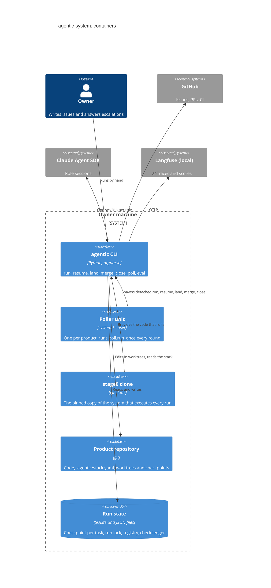

# Contenedores

Vista de contenedores (C4, nivel 2): los procesos y directorios en que se reparte el
sistema cuando corre. Contexto en [contexto](contexto.md); sus partes internas en
[componentes](componentes.md).

## La CLI `agentic`

Es el adaptador de entrada: `agentic/cli.py:main` arma el árbol de comandos con
`agentic/cli.py:build_parser`, carga el `.env`, compone los puertos reales con
`agentic/composition.py:default_ports` y despacha al verbo. Los verbos (`run`, `resume`,
`close`, `merge`, `land`, `eval`, `stack`, `scores`, `dashboards`, `poll`, `reflect`,
`perf`) están descritos, uno por uno, en la [referencia de la CLI](../reference/cli.md).
`run` y `resume` compilan el grafo de roles con el checkpointer SQLite
(`agentic/composition.py:checkpointer`) y lo invocan; el grafo es
`agentic/composition.py:graph` y su diagrama está en el
[grafo de roles](generated/role-graph.md).

Antes de invocar el grafo, cada verbo que corre una tarea toma el lock de la tarea en
`.agentic/runs/` (`agentic/core/process/adapters/filesystem/lock.py:FilesystemRunLock`) y se
anota en el registro de corridas
(`agentic/core/process/adapters/filesystem/run_registry.py:FilesystemRunRegistry`); con
`--detach` la CLI se vuelve a ejecutar en una sesión propia
(`agentic/cli.py:_spawn_detached`) y el padre sale.

## Las unidades del poller

Hay un poller por producto, como servicio de usuario de systemd. Se instala con
`scripts/install-poller.sh`, que renderiza la plantilla
`scripts/systemd/agentic-poll.service.in`; la unidad corre `agentic poll --product-dir <dir>`
desde el stage0 (`Restart=on-failure`, `KillMode=process`, para que reiniciarlo no mate las
corridas que lanzó). El bucle es `agentic/cli.py:_poll`: una ronda de
`agentic/core/process/application/poll.py:run_once` cada cierto intervalo, bajo un lock por
producto. Una ronda reúne lo que hay que hacer (lanzar tareas nuevas, reanudar las
pausadas, aterrizar y mergear pull requests, cerrar) y lo decide en
`agentic/core/process/domain/rules.py:poll_plan`. El poller no corre ningún rol: lanza
procesos hijos con `agentic/cli.py:SpawnLauncher`, y cada hijo es una invocación de la CLI.

## El clon stage0

El sistema que ejecuta una corrida no es el que la corrida edita (ADR-0017). Por eso
`scripts/stage0.sh <ref>` clona el repo y lo fija a un sha, normalmente en
`~/.agentic-stage0`, y `agentic/shared/stage0.py:CHECKOUT` dice dónde está el checkout desde el
que se importó el paquete. Actualizarlo es un acto explícito. El preflight se niega a
correr un producto que sea el propio checkout
(`agentic/core/process/application/preflight.py:refuse_its_own_checkout`).

## Los repos de producto y sus worktrees

Un producto es un repo aparte con su `.agentic/stack.yaml`. El sistema le escribe en
tres lugares:

- el documento de la tarea, bajo `.agentic/tasks/`
  (`agentic/core/process/adapters/filesystem/documents.py:FilesystemTaskDocuments`);
- los worktrees de git, en `.agentic/worktrees/`: uno por tarea y uno por subtarea, sobre
  ramas `agentic/<tarea>` (`agentic/core/process/adapters/git/workspace.py:WORKTREES`,
  `agentic/core/process/adapters/git/workspace.py:GitWorkspace`);
- el checkpoint de la tarea, un archivo SQLite que espera la reanudación
  (`agentic/composition.py:checkpointer`, ADR-0003).

`agentic/core/process/adapters/git/workspace.py:GitWorkspace.exclude_system_files` deja todo
eso fuera de lo que git versiona. Los scratch de los chequeos viven fuera del repo
(`agentic/core/process/adapters/filesystem/scratch.py:FilesystemScratch`, ADR-0072).
