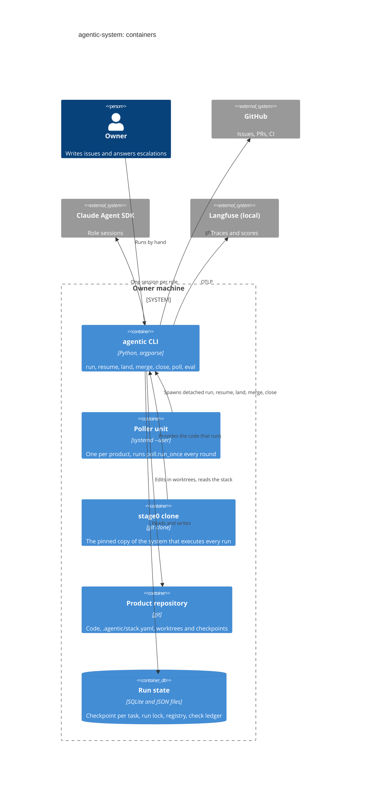

# Contenedores

Vista de contenedores (C4, nivel 2): los procesos y directorios en que se reparte el
sistema cuando corre. Contexto en [contexto](contexto.md); sus partes internas en
[componentes](componentes.md).

## La CLI `agentic`

Es el adaptador de entrada: `agentic/cli.py:main` arma el árbol de comandos con
`agentic/cli.py:build_parser`, carga el `.env`, compone los puertos reales con
`agentic/composition.py:default_ports` y despacha al verbo. Los verbos (`run`, `resume`,
`close`, `merge`, `land`, `eval`, `stack`, `scores`, `dashboards`, `poll`, `reflect`,
`perf`) están descritos, uno por uno, en la [referencia de la CLI](../reference/cli.md).
`run` y `resume` compilan el grafo de roles con el checkpointer SQLite
(`agentic/composition.py:checkpointer`) y lo invocan; el grafo es
`agentic/composition.py:graph` y su diagrama está en el
[grafo de roles](generated/role-graph.md).

Antes de invocar el grafo, cada verbo que corre una tarea toma el lock de la tarea en
`.agentic/runs/` (`agentic/core/process/adapters/filesystem/lock.py:FilesystemRunLock`) y se
anota en el registro de corridas
(`agentic/core/process/adapters/filesystem/run_registry.py:FilesystemRunRegistry`). El mismo
registro guarda `flakes/<producto>.lock`, el lock por producto que el archivado de issues de flake
toma, con espera acotada, solo cuando una clave pasó el umbral
(`FilesystemRunRegistry.flake_lock`, ADR-0085); con `--detach` la CLI se vuelve a ejecutar en una sesión propia
(`agentic/cli.py:_spawn_detached`) y el padre sale.

## Las unidades del poller

Hay un poller por producto, como servicio de usuario de systemd. Se instala con
`scripts/install-poller.sh`, que renderiza la plantilla
`scripts/systemd/agentic-poll.service.in`; la unidad corre `agentic poll --product-dir <dir>`
desde el stage0 (`Restart=on-failure`, `KillMode=process`, para que reiniciarlo no mate las
corridas que lanzó). El bucle es `agentic/cli.py:_poll`: una ronda de
`agentic/core/process/application/poll.py:run_once` cada cierto intervalo, bajo un lock por
producto. Cada ronda lee `upstream()` una sola vez (un fetch) y, antes de `run_once`, compara
el checkout del producto con esa punta, solo leyendo (`Workspace.fast_forward_view`,
`rules.fast_forward_blocked`): si no puede avanzar con fast-forward (`diverged` o
`would_overwrite`) avisa con una línea, una sola por cambio de estado, porque el stack que se
lee de ese checkout queda viejo. Una ronda reúne lo que hay que hacer (lanzar tareas nuevas, reanudar las
pausadas, aterrizar y mergear pull requests, cerrar) y lo decide en
`agentic/core/process/domain/rules.py:poll_plan`. El poller no corre ningún rol: lanza
procesos hijos con `agentic/cli.py:SpawnLauncher`, y cada hijo es una invocación de la CLI.

`agentic poll --product-dir <dir> --dry-run --once` es la ronda de prueba (GH-622): lee todo y
no escribe nada. `--once` solo se acepta junto con `--dry-run`, y `--dry-run` se rechaza con
`--detach` (salida 2). En ese modo `_poll` no toma el lock por producto, no crea un
`SpawnLauncher`, no pide el archivo de log (`_log_file_for`) ni duerme: llama a
`agentic/cli.py:_dry_round`, que envuelve los puertos, el registro y el lock con
`agentic/core/process/application/dry_run.py:read_only_ports`. Cada puerto queda detrás de un
`ReadOnly`: una lectura de la tabla `READS` delega, una escritura clasificada solo se anota
(`DryRunLog.writes`, la línea `would <puerto>.<método>`) y devuelve un valor neutro, y un
nombre sin clasificar se anota en `DryRunLog.refused` y levanta `DryRunRefused`. La única
excepción declarada es `Workspace.upstream()` (el fetch), que es una lectura.
`run_once(dry_run=True)` no ejecuta los siete barridos (`close_issues.sweep`,
`split_sweep.sweep`, `scratch_sweep.sweep`, `ci_ref_sweep.sweep`, `poll.flag_stranded` en
`agentic/core/process/application/poll.py`, que avisa una tarea `tracker_only` varada tras una
reanudación de estimación (GH-798), `board_sync.mirror` y
`worktree_sweep.sweep`: una línea `dry-run: skipped <barrido>` cada uno), ni `execute`, ni `reflect_lines`; en lugar de lanzar
imprime `would <tipo> issue <N>` por cada acción del plan. Por eso un bloqueador que el barrido
de cierre cerraría en esa ronda sigue abierto y su dependiente no se lanza (GH-348). La salida
es el aviso inicial, las líneas de la ronda, las notas `would ...` y una línea
`dry-run: unclassified <Puerto>.<nombre>` por cada rechazo. Termina con 0; con 1 si hubo algún
rechazo o si el tracker falló (`TrackerCallFailed`, `round ended early`).

Cada ronda de `agentic/cli.py:_poll` que corre (una ronda saltada por el límite de GitHub, más abajo, no
imprime la línea ni corre el paso) termina, en un `finally` (también tras `TrackerCallFailed` o
cualquier otra excepción) y antes del sleep, con la línea `agentic: poll: graphql budget: ...` (GH-939).
La arma `agentic/core/process/application/budget_round.py:budget_round`: drena el registro de
llamadas `gh`, lee `gh api rate_limit` con `agentic/composition.py:budget_read` (acotada a
`BUDGET_READ_TIMEOUT_S` = 5 s y nunca contada en ningún `GhCallLog` real) y calcula los puntos de
la ronda con `agentic/core/process/domain/github_budget.py:round_points`. Solo corre si `main` pasa `budget_read` y
`gh_calls`; sin alguno de los dos, `_poll` no imprime ni drena nada. La lectura es síncrona y puede
frenar el lazo hasta unos 5 s, igual que las demás llamadas `gh` de la ronda.

Límite de GraphQL de GitHub (GH-1214): `gh issue list` imprime `GraphQL: API rate limit already
exceeded`, y `agentic/core/process/adapters/github/run.py:_retryable_kind` lo clasifica como
`rate_limited` junto al mensaje REST, con la tupla `GH_RATE_LIMIT_MARKERS` (minúsculas). La política
de reintento espera el reset y, pasado su tope, levanta `TrackerRateLimited(resets_at=...)`. Si una
ronda de `_poll` termina en esa excepción, el lazo fija su local `rate_limited_until` con
`agentic/core/process/domain/rate_limit.py:skip_until` (el `governing_reset` del producto, con tope
`RATE_LIMIT_WAIT_MAX` desde ahora; `None` sin `resets_at`). Mientras
`rate_limit.py:round_skip` devuelva ese instante (`ahora < until <= ahora + RATE_LIMIT_WAIT_MAX`), la
ronda solo escribe los latidos `start` y `end`, imprime `agentic: poll: round skipped: GitHub rate
limit until <ISO>` y duerme `interval_s`: no llama a `gh`, ni a `upstream()`, ni a `run_once`, ni al
paso del presupuesto. `_reexec` y `_reap_inherited` sí corren antes del chequeo. Una ronda saltada
nunca escribe ni extiende `rate_limited_until`; cuando `round_skip` da `None` el local se limpia y la
ronda corre como siempre. El local vive solo en memoria (fila en `tests/test_poll_inventory.py`).

Al final de cada ronda, `poll.run_once` corre el barrido de worktrees (GH-824): borra los
checkouts bajo `.agentic/worktrees` de las tareas cuyo issue está CLOSED, nunca las ramas. Corre
después de `execute` y antes de `board_sync.mirror`, fuera de `registry.exclusive()`, y solo si la
ronda no está retenida, no es dry run y hay un `worktree_sweep.SweepCarry`: el lazo de
`cli._poll` crea uno como local y lo pasa en cada ronda, y `_dry_round` no pasa ninguno. El carry
guarda la memoria del barrido y `held_said`; reiniciar el poller los pierde. La función
`poll._sweep_busy` arma el conjunto de tareas que el barrido deja para la ronda siguiente: las
corridas vivas de este producto (`registry.live()` fresco) y la tarea de toda acción de la ronda,
cierres incluidos. Una ronda retenida con carry dice una sola vez por proceso
`agentic: poll: worktrees: not swept while held`.

## El clon stage0

El sistema que ejecuta una corrida no es el que la corrida edita (ADR-0017). Por eso
`scripts/stage0.sh <ref>` clona el repo y lo fija a un sha, normalmente en
`~/.agentic-stage0`, y `agentic/shared/stage0.py:CHECKOUT` dice dónde está el checkout desde el
que se importó el paquete. Actualizarlo es un acto explícito. El preflight se niega a
correr un producto que sea el propio checkout
(`agentic/core/process/application/preflight.py:refuse_its_own_checkout`).

## Los repos de producto y sus worktrees

Un producto es un repo aparte con su `.agentic/stack.yaml`. El sistema le escribe en
tres lugares:

- el documento de la tarea, bajo `.agentic/tasks/`
  (`agentic/core/process/adapters/filesystem/documents.py:FilesystemTaskDocuments`);
- los worktrees de git, en `.agentic/worktrees/`: uno por tarea y uno por subtarea, sobre
  ramas `agentic/<tarea>` (`agentic/core/process/adapters/git/workspace.py:WORKTREES`,
  `agentic/core/process/adapters/git/workspace.py:GitWorkspace`);
- el checkpoint de la tarea, un archivo SQLite que espera la reanudación
  (`agentic/composition.py:checkpointer`, ADR-0003).

`agentic/core/process/adapters/git/workspace.py:GitWorkspace.exclude_system_files` deja todo
eso fuera de lo que git versiona. Los scratch de los chequeos viven fuera del repo
(`agentic/core/process/adapters/filesystem/scratch.py:FilesystemScratch`, ADR-0072).
