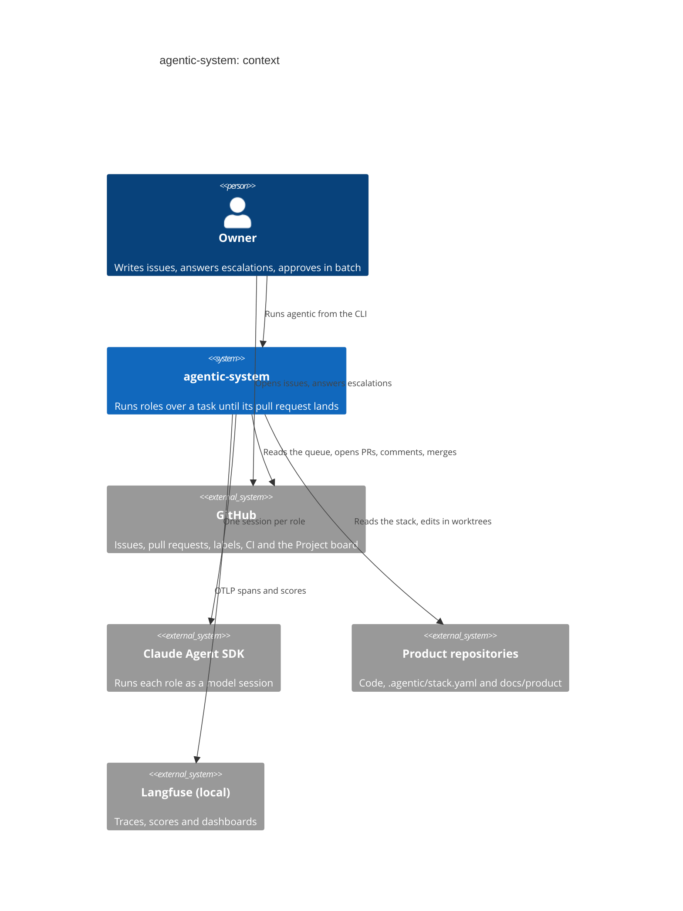

# Contexto

Vista de contexto (C4, nivel 1) de agentic-system: quién lo usa y con qué sistemas
externos habla. El sistema es un desarrollador de software agéntico; recibe trabajo como
issues de GitHub, lo hace con modelos de Claude y deja pull requests. No expone ninguna API
HTTP: sus interfaces son la CLI `agentic` y el contrato que cada producto declara en
`.agentic/stack.yaml` (ver [referencia de la CLI](../reference/cli.md) y
[referencia de `stack.yaml`](../reference/stack-yaml.md)).

## Quién es quién

- **Dueño (Owner).** Es el *Humano* del glosario de `agentic/core/process/CONTEXT.md`:
  aprobador y destino de los escalados. Escribe los issues que el sistema atiende y
  contesta con un comentario cuando una corrida se escala. Lo hace por GitHub o con
  `agentic resume`, definido en `agentic/cli.py:build_parser`.
- **GitHub.** Es la cola de trabajo y el canal con el dueño. Los adaptadores están en
  `agentic/core/process/adapters/github/`: `GhInbox` lee la cola de issues
  (`agentic/core/process/adapters/github/inbox.py:GhInbox`), `GhTracker` abre pull requests,
  comenta, etiqueta y mergea (`agentic/core/process/adapters/github/tracker.py:GhTracker`)
  y `GhBoard` espeja el estado en el Project
  (`agentic/core/process/adapters/github/board.py:GhBoard`, ADR-0073). Todos usan el
  binario `gh`.
- **Claude Agent SDK.** Cada rol corre como una sesión del SDK, en una jaula con
  herramientas y permisos propios:
  `agentic/core/process/adapters/claude_sdk/runner.py:ClaudeSdkRunner`.
- **Productos.** Son repositorios aparte (ADR-0002). El sistema se mete en ellos solo por
  lo que declaran en `.agentic/stack.yaml`, que lee
  `agentic/core/knowledge/domain/stack.py`, y por el conocimiento que guardan bajo
  `docs/product/`. `agentic/core/knowledge/adapters/git/stack.py:GitStack` lee el stack
  tal como lo fija el commit base. El propio agentic-system es un producto más, que corre
  desde un clon aparte (ver [contenedores](contenedores.md)).
- **Langfuse local.** Es el único destino de la observabilidad (ADR-0037). Los spans de
  cada rol salen por OTLP desde
  `agentic/core/measurement/adapters/otel/telemetry.py:configure` y los puntajes de las
  tareas cerradas los escribe
  `agentic/core/measurement/adapters/langfuse/scores.py:LangfuseScores`. Sin
  `OTEL_EXPORTER_OTLP_ENDPOINT` no se exporta nada.

## Dónde seguir

La [vista de contenedores](contenedores.md) abre el sistema en procesos y directorios, y
la [vista de componentes](componentes.md) lo abre en módulos y puertos. Los
[flujos](flujos/de-issue-a-merge.md) cuentan qué pasa con una tarea.
