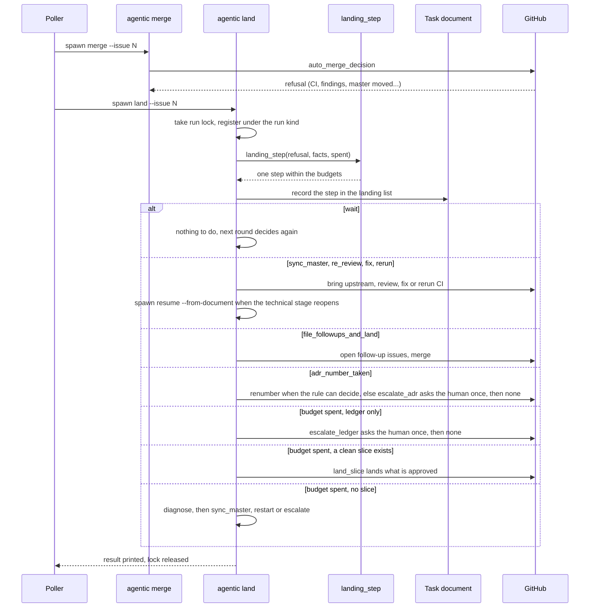

# Aterrizaje

Qué hace el sistema con un pull request aprobado cuyo merge `auto_merge_decision` rechazó,
en vez de dejarlo al humano (ADR-0048, [el sistema aterriza sus propios pull requests](../../adr/0048-el-sistema-aterriza-sus-propios-pull-requests.md)).
Un Aterrizaje no es una Reanudación: una reanudación retoma una corrida cortada, un
aterrizaje trabaja sobre un pull request ya entregado (glosario en
`agentic/core/process/CONTEXT.md`).

## Paso por paso

1. **El rechazo.** `agentic/cli.py:_merge` pregunta a
   `agentic/core/process/domain/rules.py:auto_merge_decision` si mergear. Cuando dice que no,
   el motivo es uno de los rechazos de la tabla del ADR-0048: CI sin terminar o roto,
   hallazgos abiertos, cabeza no revisada, master movido, intentos agotados.
2. **El poller lanza `land`.** `agentic/core/process/application/poll.py:gather_merges`
   reúne también los candidatos a aterrizar, y
   `agentic/core/process/application/poll.py:execute` lanza `agentic land --issue N`. El
   verbo es `agentic/cli.py:_land`; corre bajo el lock de la tarea y registrado con el tipo
   de corrida con que se lo lanzó (`land_checks` si no gasta modelo, `land_model` si sí).
3. **Un solo paso, elegido por una tabla.**
   `agentic/core/process/domain/landing.py:landing_step` es el único lugar que decide *qué
   hacer en vez de* mergear. El paso queda en la lista `landing` del documento antes de
   ejecutarse, y cada tipo de paso tiene su brazo en
   `agentic/core/process/application/landing.py:_dispatch`.
4. **Los pasos.** `LandingStepKind` tiene 15 tipos
   (`agentic/core/process/domain/landing.py:LandingStepKind`), cada uno con su brazo en
   `_dispatch`. Con modelo o con el upstream: traer el upstream (`sync_master`), volver a
   revisar (`re_review`), corregir (`fix`), el pase final sobre los importantes propios
   (`fix_important`), repetir el CI o los chequeos (`rerun`), archivar el seguimiento de lo
   que quedó fuera de alcance y mergear (`file_followups_and_land`), renumerar el ADR cuyo
   número ya tomó master (`renumber`), aterrizar por tramos (`land_slice`) y diagnosticar
   (`diagnose`). Sin gastar modelo: esperar (`wait`), escribir lo que la aprobación vigente de
   PM cubre (`settle`), preguntarle una vez al humano por lo que no cubre (`escalate_ledger`) o por una colisión de
   números de ADR que la regla no puede decidir (`escalate_adr`),
   escalar (`escalate`) y no hacer nada (`none`). Los brazos están en
   `agentic/core/process/application/landing_sync.py`,
   `agentic/core/process/application/landing_fix.py` y
   `agentic/core/process/application/landing_slice.py`.
5. **Cuando el paso reabre el stage técnico.** Un `fix` o un `re_review` que necesita a un
   Developer lanza una reanudación desde el documento
   (`agentic/cli.py:_resume_spawner`: `agentic resume --issue N --from-document --yes --detach`)
   y espera a que se registre.
6. **Presupuestos.** Los pases del modelo y las sincronizaciones tienen topes por tarea
   (`agentic/core/process/domain/landing.py:LANDING_PASSES_MAX`,
   `agentic/core/process/domain/landing.py:LANDING_SYNCS_MAX`). Cuando uno se agota, todos
   terminan en el mismo lugar, `exhausted()` dentro de `landing_step`: si el rechazo es solo
   del libro mayor (`ledger_only`), el paso es `escalate_ledger`, o `none` si ya se preguntó;
   si no, es `land_slice` cuando existe un tramo limpio ya aprobado, y `diagnose` solo cuando
   no. El diagnóstico tiene un veredicto cerrado, `sync` o `unlandable`, y
   `agentic/core/process/domain/landing.py:after_diagnosis` lo convierte en una sincronización
   más (`sync_master`), un reinicio (`restart`) o un escalado (`escalate`). El reinicio es el
   último recurso: avisa en el issue con el motivo y el costo hasta ese momento.
   El rechazo `adr_number_taken` no pasa por `exhausted()`: es `renumber` cuando la regla decide
   la colisión y quedan renumeraciones (`LANDING_RENUMBERS_MAX`); si no, una sola `escalate_adr`
   por (cabeza, rechazo), y después `none`. Nunca `diagnose` ni `restart` (ADR-0049, adenda GH-412).
7. **Un escalado se libera por una sola decisión (GH-442).** Un documento escalado cuyo paso
   de la tabla es `diagnose` no se despacha: `agentic/core/process/application/landing.py:_land`
   (y el poller, en `gather_merges`) preguntan a
   `agentic/core/process/application/landing_plan.py:release` si el escalado se libera, bajo la
   condición `landing_plan.release_asked`. La respuesta (`Release.released`) es verdadera por
   una decisión humana (`landing.released`) o, si el escalado lo causó solo el CI, porque el CI
   de la rama base volvió a verde (`landing.released_by_ci`, que no escribe `### Decision` ni
   texto en `Human`). Liberado, el paso se recalcula sobre la vista liberada
   (`landing_plan.released_step`): `sync_master` si la cabeza no contiene el upstream, `rerun`
   si lo contiene, `wait` si la ascendencia no se puede leer. Ese paso pasa de nuevo por
   `run_kind_admits` y `takes_action` antes de escribir la entrada `landing`; el `ci_released`
   y la entrada del paso siguiente se guardan en la misma escritura de `record_closure` (la
   liberación misma se guarda antes, como la de GH-328). Un escalado que no es de CI (libro
   mayor, ADR, diagnóstico de profundidad 1, GH-328) conserva su comportamiento.
   `agentic resume` consulta la misma decisión
   (`agentic/core/process/application/resume.py:_landing_owns_line`) y solo nombra
   `agentic land` si `land` puede mover la tarea; si espera la CI de la base o un comentario
   humano, lo dice sin mencionar `--fresh`.
