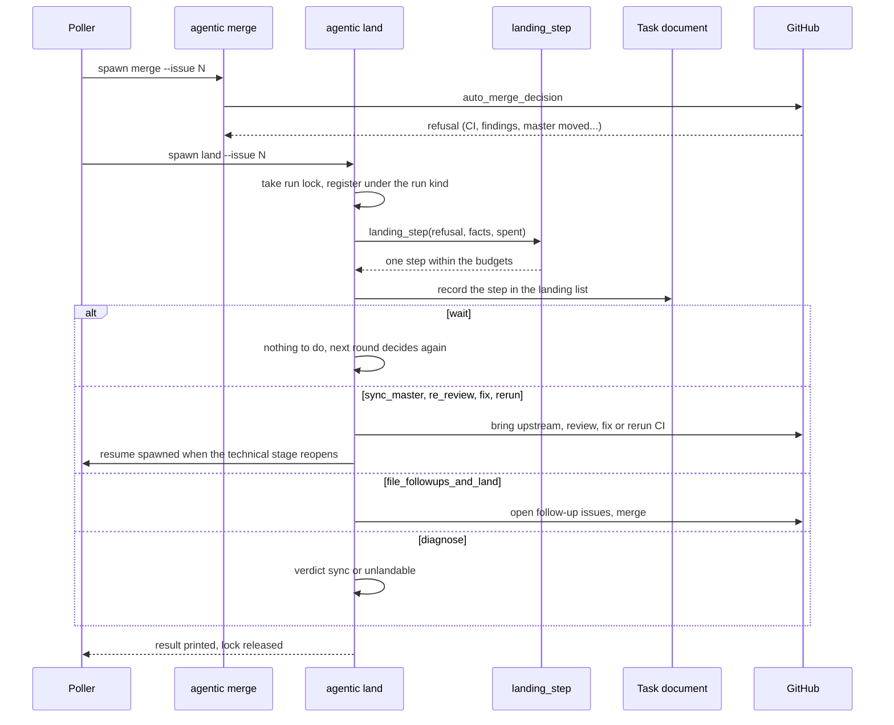

# Aterrizaje

Qué hace el sistema con un pull request aprobado cuyo merge `auto_merge_decision` rechazó,
en vez de dejarlo al humano (ADR-0048, [el sistema aterriza sus propios pull requests](../../adr/0048-el-sistema-aterriza-sus-propios-pull-requests.md)).
Un Aterrizaje no es una Reanudación: una reanudación retoma una corrida cortada, un
aterrizaje trabaja sobre un pull request ya entregado (glosario en
`agentic/core/process/CONTEXT.md`).

## Paso por paso

1. **El rechazo.** `agentic/cli.py:_merge` pregunta a
   `agentic/core/process/domain/rules.py:auto_merge_decision` si mergear. Cuando dice que no,
   el motivo es uno de los rechazos de la tabla del ADR-0048: CI sin terminar o roto,
   hallazgos abiertos, cabeza no revisada, master movido, intentos agotados.
2. **El poller lanza `land`.** `agentic/core/process/application/poll.py:gather_merges`
   reúne también los candidatos a aterrizar, y
   `agentic/core/process/application/poll.py:execute` lanza `agentic land --issue N`. El
   verbo es `agentic/cli.py:_land`; corre bajo el lock de la tarea y registrado con el tipo
   de corrida con que se lo lanzó (`land_checks` si no gasta modelo, `land_model` si sí).
3. **Un solo paso, elegido por una tabla.**
   `agentic/core/process/domain/landing.py:landing_step` es el único lugar que decide *qué
   hacer en vez de* mergear. El paso queda en la lista `landing` del documento antes de
   ejecutarse, y cada tipo de paso tiene su brazo en
   `agentic/core/process/application/landing.py:_dispatch`.
4. **Los pasos.** Esperar (`wait`), traer el upstream (`sync_master`), volver a revisar
   (`re_review`), corregir (`fix`), repetir el CI o los chequeos (`rerun`), archivar el
   seguimiento de lo que quedó fuera de alcance y mergear (`file_followups_and_land`),
   renumerar el ADR cuyo número ya tomó master (`renumber`), aterrizar por tramos
   (`land_slice`) o diagnosticar (`diagnose`). Los brazos están en
   `agentic/core/process/application/landing_sync.py`,
   `agentic/core/process/application/landing_fix.py` y
   `agentic/core/process/application/landing_slice.py`.
5. **Cuando el paso reabre el stage técnico.** Un `fix` o un `re_review` que necesita a un
   Developer lanza una reanudación desde el documento
   (`agentic/cli.py:_resume_spawner`: `agentic resume --issue N --from-document --yes --detach`)
   y espera a que se registre.
6. **Presupuestos.** Los pases del modelo y las sincronizaciones tienen topes por tarea
   (`agentic/core/process/domain/landing.py`); un paso que los excedería es `diagnose`. El
   diagnóstico tiene un veredicto cerrado, `sync` o `unlandable`, y solo el reinicio es el
   último recurso: avisa en el issue con el motivo y el costo hasta ese momento.
