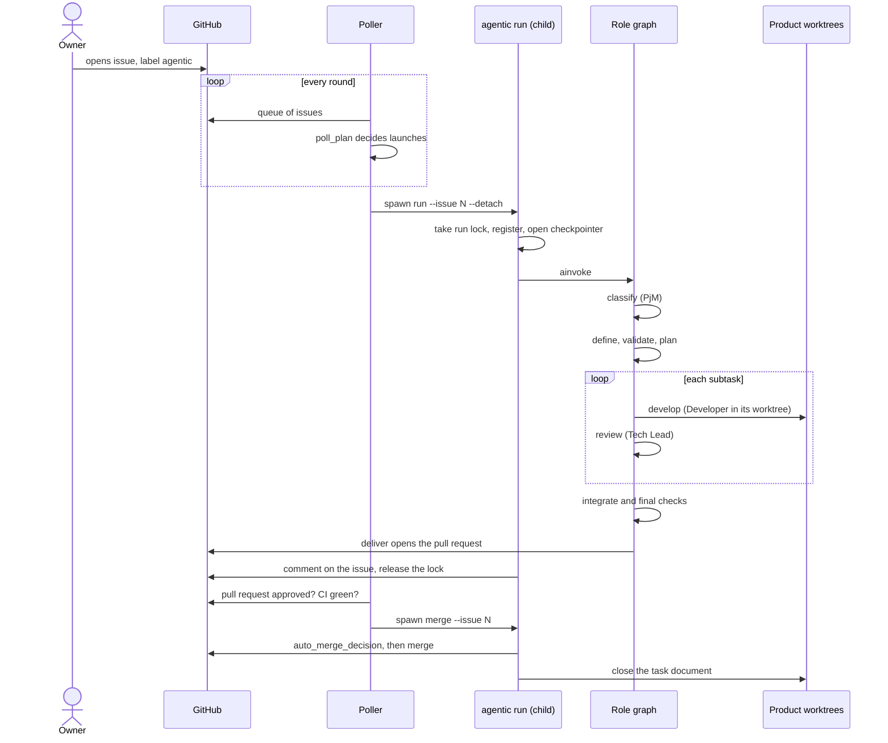

# De un issue a su merge

Qué pasa con una tarea desde que el dueño abre el issue hasta que su pull request se
mergea. Los términos (Corrida, Escalado, Aterrizaje...) son los del glosario de
`agentic/core/process/CONTEXT.md`. El grafo de roles completo está en el
[grafo de roles](../generated/role-graph.md).

## Paso por paso

1. **Entrada.** El dueño abre un issue con la etiqueta `agentic`. El poller lo ve en
   `agentic/core/process/application/poll.py:gather_launches`, que reúne los issues
   abiertos con esa etiqueta y sin documento de tarea todavía.
2. **Decisión y lanzamiento.** `agentic/core/process/domain/rules.py:poll_plan` decide
   cuántas corridas caben bajo `max_concurrent_runs` y
   `agentic/core/process/application/poll.py:execute` lanza un hijo
   `agentic run --issue N --detach` por medio de `agentic/cli.py:SpawnLauncher`. El poller
   no corre ningún rol.
3. **Corrida.** `agentic/cli.py:_run` toma el lock de la tarea, la registra, abre el
   checkpointer (`agentic/composition.py:checkpointer`) e invoca el grafo
   `agentic/composition.py:graph`.
4. **Camino.** `classify` (PjM) elige el tipo: feature, bug o platform enhancement
   (README.md, sección 2). Una feature pasa por `define` (Product Analyst) y `validate`
   (PM) antes de `plan` (Tech Lead); un bug reemplaza la definición por `diagnose`; un
   platform enhancement la salta. Las aristas están en
   `agentic/core/process/adapters/langgraph/graph.py:build_graph` y sus reglas en
   `agentic/core/process/domain/rules.py`.
5. **Desarrollo.** El nodo `pipeline` corre, por cada subtarea, el subgrafo `develop` →
   `review` (`agentic/core/process/adapters/langgraph/graph.py:pipeline_branch`). Cada
   Developer trabaja en un worktree propio
   (`agentic/core/process/adapters/git/workspace.py:WORKTREES`) y su par es Tech Lead. El
   orden en que arrancan las subtareas lo decide
   `agentic/core/process/application/schedule.py:run_subtasks`.
6. **Integración y entrega.** `integrate` une las ramas de las subtareas; los pasos finales
   (`final_validation`, `copy_review`, `qa_performance`, `owner_rules`, `full_checks`)
   corren según el plan; `owner_rules` anexa en la rama de la tarea las reglas que el dueño
   marcó con `Owner's rule:` en el issue (`agentic/core/process/application/owner_rules.py`); `deliver` empuja la rama y abre el pull request con `Tracker.open_pull_request`
   (`agentic/core/process/application/deliver.py:deliver`).
7. **Merge.** En rondas siguientes el poller reúne los pull requests entregados
   (`agentic/core/process/application/poll.py:gather_merges`) y lanza
   `agentic merge --issue N` (`agentic/cli.py:_merge`). Este verbo llama a
   `agentic/core/process/application/merge.py:merge_task`, que mergea solo si
   `agentic/core/process/domain/rules.py:auto_merge_decision` lo permite, y después cierra
   el documento de la tarea (`agentic/cli.py:_close_document`).

## Cuando algo no sigue

- Si un rol, un par o el tope no pueden seguir, la tarea se escala y se pausa: ver
  [reanudación](reanudacion.md).
- Si `auto_merge_decision` rechaza el merge de un pull request aprobado, el sistema lo
  aterriza solo: ver [aterrizaje](aterrizaje.md).
