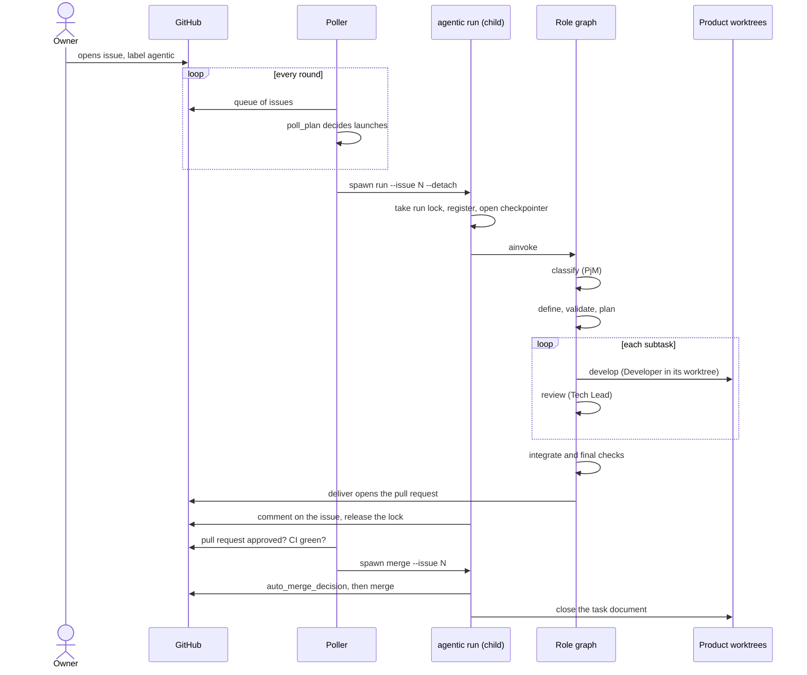

# De un issue a su merge

Qué pasa con una tarea desde que el dueño abre el issue hasta que su pull request se
mergea. Los términos (Corrida, Escalado, Aterrizaje...) son los del glosario de
`agentic/core/process/CONTEXT.md`. El grafo de roles completo está en el
[grafo de roles](../generated/role-graph.md).

## Paso por paso

1. **Entrada.** El dueño abre un issue con la etiqueta `agentic`. El poller lo ve en
   `agentic/core/process/application/poll.py:gather_launches`, que reúne los issues
   abiertos con esa etiqueta y sin documento de tarea todavía.
2. **Decisión y lanzamiento.** `agentic/core/process/domain/rules.py:poll_plan` decide
   cuántas corridas caben bajo `max_concurrent_runs` y
   `agentic/core/process/application/poll.py:execute` lanza un hijo
   `agentic run --issue N --detach` por medio de `agentic/cli.py:SpawnLauncher`. El poller
   no corre ningún rol. El único hijo exento (merge o `land_checks`) que la máquina permite
   no va al número de issue más bajo: `poll_plan` elige al candidato que más tiempo lleva
   sin intento (`agentic/core/process/domain/exempt_queue.py:rank`, la Cola exenta), y un
   merge rechazado por `ci_untrusted_no_dispatch` sobre el mismo head y master queda en
   `backoff` hasta que uno se mueva.
3. **Corrida.** `agentic/cli.py:_run` toma el lock de la tarea, la registra, abre el
   checkpointer (`agentic/composition.py:checkpointer`) e invoca el grafo
   `agentic/composition.py:graph`.
4. **Camino.** `classify` (PjM) elige el tipo: feature, bug o platform enhancement
   (README.md, sección 2). Una feature pasa por `define` (Product Analyst) y `validate`
   (PM) antes de `plan` (Tech Lead); un bug reemplaza la definición por `diagnose`; un
   platform enhancement la salta. Una feature o un bug en el camino ligero (`path: light`,
   ver `agentic/core/process/domain/task_path.py:path_of`) va de `classify` directo a `plan`
   (`agentic/core/process/domain/rules.py:after_classify`); una promoción a `full` lo manda de
   vuelta a `define` o `diagnose` (`agentic/core/process/domain/rules.py:promotion_route`) y
   el plan se revisa sin tocar las ramas. Las aristas están en
   `agentic/core/process/adapters/langgraph/graph.py:build_graph` y sus reglas en
   `agentic/core/process/domain/rules.py`.
5. **Desarrollo.** El nodo `pipeline` corre, por cada subtarea, el subgrafo `develop` →
   `review` (`agentic/core/process/adapters/langgraph/graph.py:pipeline_branch`). Cada
   Developer trabaja en un worktree propio
   (`agentic/core/process/adapters/git/workspace.py:WORKTREES`) y su par es Tech Lead. El
   orden en que arrancan las subtareas lo decide
   `agentic/core/process/application/schedule.py:run_subtasks`. Bajo `review_mode: single`
   (ADR-0088) el sistema aprueba cada rama sin correr un rol (`rules.system_approves`,
   `rules.approval_patch`): la única revisión del Tech Lead es la de la integración, con como
   mucho 2 rondas de arreglo, y la revisión de hoy corre en paralelo como sombra que no
   decide nada (`agentic/core/process/application/shadow_review.py`).
   Cuando el par Tech Lead→Developer de una subtarea llega a su tope de devoluciones, la
   primera vez no escala: `agentic/core/process/application/review.py:review` pregunta a
   `agentic/core/process/domain/restart.py:on_return_limit` y, si la subtarea nunca se
   aprobó y no hay pull request, la reinicia limpia con un brief reescrito
   (`agentic/core/process/domain/restart.py:restart_patch`, que deja `restart_pending`).
   El siguiente `develop` termina el reinicio: archiva el intento en
   `archive/restart<k>-<commit>/<rama>`
   (`agentic/core/process/application/archive.py:archive_subtask`), recrea la rama desde
   la base y arma el prompt del Developer solo con la sección `Restart <subtarea>`, sin
   sesión previa (`agentic/core/process/application/develop.py:develop`). El intento
   reiniciado tiene su propio contador y, si también llega al tope, escala.
6. **Integración y entrega.** `integrate` une las ramas de las subtareas; `owner_rules` y el pase
   de `fix_important` corren en serie y mueven la cabeza; después `verify` corre juntos, sobre
   esa cabeza, los verificadores que el plan convoca (`final_validation`, `copy_review`,
   `qa_performance`, `full_checks`; `agentic/core/process/application/verifiers.py:verify`) y
   `deliver` espera a todos; `owner_rules` anexa en la rama de la tarea las reglas que el dueño
   marcó con `Owner's rule:` en el issue (`agentic/core/process/application/owner_rules.py`); `deliver` empuja la rama y abre el pull request con `Tracker.open_pull_request`
   (`agentic/core/process/application/deliver.py:deliver`). Cuando el stack declara
   `api_break_line` y la tarea tiene un motivo registrado, el cuerpo de la primera entrega lleva
   la línea `Breaking-API:` primero; en una reentrega `deliver` lee el cuerpo
   (`Tracker.pull_request_body`), le antepone la línea si falta y lo edita
   (`Tracker.update_pull_request_body`) antes del push. Sin clave o sin motivo, nada de esto ocurre
   (`agentic/core/process/domain/pull_request.py:with_required_lines`).
7. **Merge.** En rondas siguientes el poller reúne los pull requests entregados
   (`agentic/core/process/application/poll.py:gather_merges`) y lanza
   `agentic merge --issue N` (`agentic/cli.py:_merge`). Este verbo llama a
   `agentic/core/process/application/merge.py:merge_task`, que mergea solo si
   `agentic/core/process/domain/rules.py:auto_merge_decision` lo permite, y después cierra
   el documento de la tarea (`agentic/cli.py:_close_document`).

## Cuando algo no sigue

- Si un rol, un par o el tope no pueden seguir, la tarea se escala y se pausa: ver
  [reanudación](reanudacion.md). Un par en su tope solo escala cuando no puede reiniciar
  (`agentic/core/process/domain/restart.py:eligible`): la subtarea ya se aprobó, ya hay pull
  request, otro rol la devolvió o ya gastó su reinicio.
- Si `auto_merge_decision` rechaza el merge de un pull request aprobado, el sistema lo
  aterriza solo: ver [aterrizaje](aterrizaje.md).
