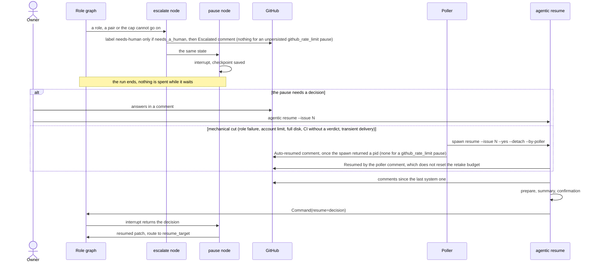

# Reanudación tras un escalado

Qué pasa cuando una tarea no puede seguir sin el humano o sin que pase algo externo, y cómo
vuelve a andar. Un Escalado y su Reanudación son términos del glosario de
`agentic/core/process/CONTEXT.md`; el mecanismo es `interrupt()` con
`Command(resume=...)` (ADR-0003, [interrupt para escalados](../../adr/0003-interrupt-para-escalados.md)).

## Paso por paso

1. **El escalado.** El caso de uso de un nodo deja el motivo en el estado; no pausa.
   `agentic/core/process/application/escalate.py:escalate`, en este orden, guarda el
   documento, pone la etiqueta `needs-human` solo si
   `agentic/core/process/domain/rules.py:needs_a_human` lo dice, y comenta el issue con el
   prefijo `Escalated: ` (`agentic/core/process/application/escalate.py:ESCALATED`). Una pausa
   causada solo por el límite de la cuenta, que el poller retoma sola, no lleva la etiqueta
   (glosario de `agentic/core/process/CONTEXT.md`). Una pausa `github_rate_limit` que no está
   persistida va más lejos: `agentic/core/process/domain/rate_limit.py:tracker_silent` vale
   verdadero y `escalate` solo guarda el documento, sin etiqueta y sin comentario `Escalated: `
   (lo mismo para el escalado `RATE_LIMIT_PERSISTED`, cuyo único escritor es el poller). El parche
   que `escalate` guarda y devuelve pasa por
   `agentic/core/process/domain/rate_limit.py:cleared_on_close`: un escalado de cualquier otra
   clase borra `rate_limit_paused_at` y `rate_limit_noticed_at` del documento, porque el próximo
   límite es una espera nueva; la pausa `github_rate_limit` los conserva.
2. **La pausa.** El nodo `pause` va después de `escalate` y no tiene efectos
   (`agentic/core/process/adapters/langgraph/graph.py:pause`). Ahí vive el `interrupt()`:
   LangGraph reanuda un nodo desde su comienzo, así que dentro de un caso de uso volvería a
   pagar el rol y dentro de `escalate` volvería a comentar el issue. La corrida termina con
   su estado en el checkpoint (`agentic/composition.py:checkpointer`).
3. **Quién reanuda.**
   - Si hace falta una decisión (preguntas abiertas, un par en su límite que ya no puede
     reiniciar, una estimación que no cabe), la toma el dueño: comenta en el issue y corre
     `agentic resume --issue N` (`agentic/cli.py:_resume`). Un reinicio limpio pendiente
     (`restart_pending`) no es una decisión ni un desacuerdo: si la corrida se cortó entre el
     reinicio y el `develop` que lo termina, la rama de la subtarea puede faltar o haberse
     movido y la reanudación no lo lee como problema
     (`agentic/core/process/application/resume.py:disagreements`).
   - Si el corte fue mecánico (un rol que falló por algo ajeno a la tarea, el límite de la
     cuenta, un disco lleno, o una escalación con una `MechanicalCause` como un CI sin
     veredicto o una entrega transitoria del sistema), el poller la retoma por su calendario,
     con el tope de `agentic/core/process/domain/rules.py:auto_resume_limit` (tres retomas
     para una causa mecánica, `agentic/core/process/domain/rules.py:schedule_for`):
     `agentic/core/process/application/poll.py:gather_resumes` evalúa cada pausa con
     `agentic/core/process/domain/rules.py:auto_resumable` y
     `agentic/core/process/domain/rules.py:next_attempt_at`, y `execute` lanza el hijo y,
     recién cuando el spawn devolvió un pid, deja el comentario `Auto-resumed: `
     (`agentic/core/process/application/poll.py:AUTO_RESUMED`). Las corridas que murieron por un
     reinicio, una caída o una señal fuera de un apagado (SIGTERM, SIGHUP, SIGINT; solo
     `agentic stop` es una parada deliberada) las retoma también el poller
     (`agentic/core/process/application/poll.py:gather_retakes`). Todo hijo que el poller lanza
     lleva `--by-poller` (`agentic/core/process/application/poll.py:_spawn_resume`) y su
     reanudación comenta `Resumed by the poller: `
     (`agentic/core/process/domain/retakes.py:RESUMED_BY_POLLER`), que a diferencia del
     `Resumed: ` de una persona no reinicia el presupuesto de retomas. Cuando ese presupuesto
     se gasta (o un lock muerto del mismo arranque, o de arranque desconocido, sin marca de caída,
     cuyo documento quedó sin tocar 24 h), el poller pone la etiqueta `needs-human` y
     deja un único comentario `Retakes spent: `
     (`agentic/core/process/application/poll.py:_announce_spent`). Si una persona habló después
     del sistema, la pausa ya es del humano y el poller no la retoma; si es un fallo de formato
     pone `needs-human` una sola vez, con `Tracker.put_label`, leyendo las etiquetas que la
     ronda ya trajo (`agentic/core/process/application/poll.py:_put_needs_human`), y un fallo
     al escribirla va a `tracker_failures` y se reintenta pasada una hora.
   - Un fallo de formato (`schema` o `check` con su regla, GH-1019) se retoma con la clave que
     decide `agentic/core/process/domain/rules.py:_resume_key` (la única que lo reconoce, por
     `format_retakes.is_format_epoch`), dos veces por regla y seis por tarea
     (`agentic/core/process/domain/rules.py:auto_resume_limit`), con el calendario de
     `agentic/core/process/domain/rules.py:RETAKE_SCHEDULE`. `execute` cuenta la retoma antes de
     lanzar el hijo, bajo `registry.exclusive()`
     (`agentic/core/process/application/poll.py:_count_format_retake`): recalcula la clave y las
     reglas sobre el documento fresco y, si el dueño llegó antes y cambiaron, no cuenta ni lanza
     y deja la línea `stale (not counted)`; si el lanzamiento falla, devuelve la cuenta
     (`agentic/core/process/application/poll.py:_restore_format_count`), pero un hijo lanzado que
     nunca se registró queda contado. Una tarea retenida (`rules.format_held`) o con un hijo vivo
     del producto no es candidata. Agotadas las retomas, la tarea escala con `needs-human`
     (`rules.needs_a_human` es verdadera hasta que sale la Nota) y el paso de retención
     (`agentic/core/process/application/poll.py:hold_format_failures`) escribe `format_hold`,
     publica la Nota `Format hold: ` y solo entonces suelta la etiqueta.
   - La pausa `github_rate_limit` no tiene comentario `Escalated: ` desde donde medir:
     `agentic/core/process/application/poll.py:gather_resumes` la delega en
     `agentic/core/process/application/poll.py:_rate_limit_candidate`, que toma el `since` del
     instante `at` de su entrada de escalado (`agentic/core/process/domain/rate_limit.py:pause_at`),
     cuenta las retomas por los `Resumed by the poller: ` posteriores a `at`
     (`agentic/core/process/domain/rate_limit.py:poller_retakes`) y, si hay un reinicio dicho,
     retoma en `resets_at` más el desfase del producto
     (`agentic/core/process/domain/rate_limit.py:governing_reset`, `retake_due_at`); sin él, por
     hora. Una persona que comenta después de `at` y del último comentario del sistema frena las
     retomas (`agentic/core/process/domain/rate_limit.py:person_spoke`). Esta pausa no gasta el
     presupuesto de retomas ni el tope mecánico, así que `execute` no deja `Auto-resumed: `;
     solo queda el `Resumed by the poller: ` de la reanudación.
   - A las 12 h contadas desde `rate_limit_paused_at`, y sin leer ningún comentario,
     `agentic/core/process/application/poll.py:rate_limit_escalations` escribe el escalado
     persistido (`agentic/core/process/domain/rate_limit.py:persist_due`) y avisa al humano: pone
     `needs-human` con `Tracker.put_label` y deja el comentario `Escalated: ` con `Tracker.note`
     (salvo que `agentic/core/process/domain/rate_limit.py:notice_posted` ya lo encuentre). Los
     fallos van a `tracker_failures` y la ronda sigue; recién con ambas escrituras se sella
     `rate_limit_noticed_at`, así que el aviso se reintenta hasta que llegó. No corre en rondas
     retenidas ni en `--dry-run`, ni sobre una tarea con corrida o lock vivos.
4. **Antes de gastar.** `agentic/core/process/application/resume.py:prepare` decide la
   reanudación: toma como decisión todos los comentarios posteriores al último del sistema
   (`agentic/core/process/application/resume.py:human_decision`), se niega si el tope ya está
   gastado y devuelve una `Resumption`. `agentic/core/process/application/resume.py:summary`
   muestra la tarea, dónde se frenó, lo gastado y qué reanuda, y la CLI pide confirmación
   salvo con `--yes`. Una pausa sobre desviaciones del dibujo no usa `human_decision`: ver 8.
5. **Retomar.** La CLI invoca el grafo con `Command(resume=...)`. `pause` devuelve el patch
   de reanudación (`agentic/core/process/domain/drawing_answer.py:resume_patch`, que compone
   `agentic/core/process/domain/rules.py:resumed`) y el ruteo va a donde el
   estado dice que se frenó (`agentic/core/process/domain/rules.py:resume_target`): una tarea
   ligera sin plan sigue a `plan` y no a `define`, y una promoción pendiente la manda primero a
   `define` o `diagnose` (`agentic/core/process/domain/rules.py:promotion_route`).
   Una reanudación con decisión de una pregunta de ajuste, o de una estimación con partes, deja
   `plan_due` y vuelve siempre a `plan`, nunca a `tracker_only`
   (`agentic/core/process/domain/rules.py:resume_target`); solo el plan que se entrega lo limpia.
   Lo mismo pasa cuando el dueño responde una pausa de desviaciones cuyo registro
   (`drawing_escalation`) tiene `stage: plan` y la reanudación responde al menos una fila:
   `agentic/core/process/domain/drawing_answer.py:plan_resume` lo decide y `resume_patch` pasa
   `drawing_plan` a `rules.resumed`, que deja `plan_due`. Sin `stage`, o con `delivery`, no.
   Excepción (GH-1004): si el dueño aceptó todas las desviaciones que declaró el plan retenido
   (`plan_held`), con una decisión de solo veredictos y sin promoción, y el chequeo de
   estimación que `resume.prepare` corre otra vez pasa, `resume_patch` restaura las subtareas
   del plan retenido: `plan_due` en falso, estado `planned`, y la tarea sigue a `integrate`
   sin planificar de nuevo (`drawing_answer.plan_stands_pre`).
6. **Si el estado guardado se perdió.** `agentic resume --issue N --from-document` siembra el
   estado desde el documento de la tarea, cruzado con git
   (`agentic/core/process/application/resume.py:from_document`), como si `escalate`
   acabara de correr.
7. **Una pausa sobre ítems de tracker (GH-620, GH-784).** Los ítems `human` que el plan deja al
   dueño los levanta el sistema al terminar el plan, antes de construir nada, como un escalado
   `questions` con `needs-human` (`agentic/core/process/domain/tracker_items.py:escalate_human`,
   llamado desde `agentic/core/process/application/plan.py:_asked`, alcanzado solo desde
   `_finished`), y `tracker_human` guarda sus hashes. `agentic/core/process/application/deliver.py:deliver`
   es solo una valla: si quedara un ítem sin preguntar, termina por `_ended` antes de empujar,
   abrir el pull request o comentar. Una respuesta dada en el plan reanuda por
   `agentic/core/process/domain/rules.py:resumed` hacia `integrate`. Mientras `agentic/core/process/domain/rules.py:tracker_item_pause` valga:
   - Una decisión en blanco no reanuda. El nodo `pause`
     (`agentic/core/process/adapters/langgraph/graph.py:_pause_node`) vuelve a llamar a
     `interrupt()` con el mismo contenido, y `agentic/core/process/application/resume.py:prepare`
     espera con el mensaje de preguntas abiertas.
   - Una tarea que ya tiene pull request (pausas anteriores a GH-784) y una decisión no escrita en blanco se resuelve sin ningún nodo
     del grafo: `prepare` devuelve una `Resumption` con `settled`, y
     `agentic/cli.py:_resume` llama a `agentic/core/process/application/resume.py:settle`, que
     guarda el patch de `agentic/core/process/domain/rules.py:resumed` (la única función que
     escribe `answered` en `tracker_actions_done`) y quita `needs-human`. El poller no la retoma:
     es una pausa humana.
   - `agentic/core/process/application/landing_plan.py:release` no libera la tarea mientras
     `tracker_human` no esté vacío, aunque haya un escalado de CI en el mismo head.
8. **Una pausa sobre desviaciones del dibujo (GH-766).** Cuando
   `agentic/core/process/domain/drawing_answer.py:prompt_cause` no es `None`,
   `agentic/core/process/application/resume.py:prepare` no lee la decisión con `human_decision`:
   `agentic/core/process/application/resume.py:_pending_drawing` toma los comentarios posteriores
   al último `Escalated: `
   (`agentic/core/process/application/resume.py:comments_since`, que salta los otros comentarios
   del sistema sin reiniciar la cuenta) y los lee por número con
   `agentic/core/process/domain/drawing.py:answers` (gana la última línea). Encima pone las
   opciones `--drawing <n>=accept|reject` (`agentic/core/process/domain/drawing.py:flag_verdicts`),
   y la opción gana sobre el comentario. Todo número abierto necesita veredicto, esté o no en la
   ronda escalada: si falta uno o está contradicho, espera (`WaitingOnHuman`, con los números y la
   pista de escribir otro comentario o usar `--drawing`; las opciones de esa llamada no se
   guardan). Se niega con `ValueError`, antes del lock y de escribir nada, una opción en una pausa
   que no es de dibujo o con una corrida caída, un número sin fila, o un número ya respondido con
   otro veredicto. El texto de la decisión (`## Human`) sale solo de ahí: los comentarios más una
   línea `Drawing <n>: <veredicto> (flag)` por opción. Las filas respondidas viajan en
   `agentic/core/process/application/resume.py:Resumption.answer` (`drawing_departures`, solo si
   hay) y `agentic/core/process/adapters/langgraph/graph.py:_pause_node` las pliega con el
   reducer en el mismo patch, que arma `agentic/core/process/domain/drawing_answer.py:resume_patch`
   sobre `rules.resumed`; el cli nunca las siembra.

   Esta pausa también nace en el plan, antes de construir nada. Con un `design` declarado en el
   commit base, `agentic/core/process/application/plan.py:_finished` mira, antes de la promoción
   y de `agentic/core/process/application/plan.py:_asked`, el plan que queda en pie: si trae
   `subtasks` (sin `parts` y no solo de tracker) y
   `agentic/core/process/domain/drawing_answer.py:plan_split` deja desviaciones abiertas, devuelve
   el patch sin `subtasks`, sin `plan_promote_request` y sin `plan_due`, más
   `agentic/core/process/domain/drawing_answer.py:escalation_patch` con `stage: plan`, que escribe
   `drawing_escalation`, el texto (`agentic/core/process/domain/drawing.py:departure_question`) y,
   en una tarea con spec, `spec_cause: drawing`. Nada se despacha ni se promueve; la respuesta
   del dueño vuelve a `plan` por la regla de 5. Sin `design` esta puerta no corre. La
   reanudación de una excepción de tracker (carve-out) llama a `_finished` sin `design`, así
   que esa ruta no pasa por esta puerta.
