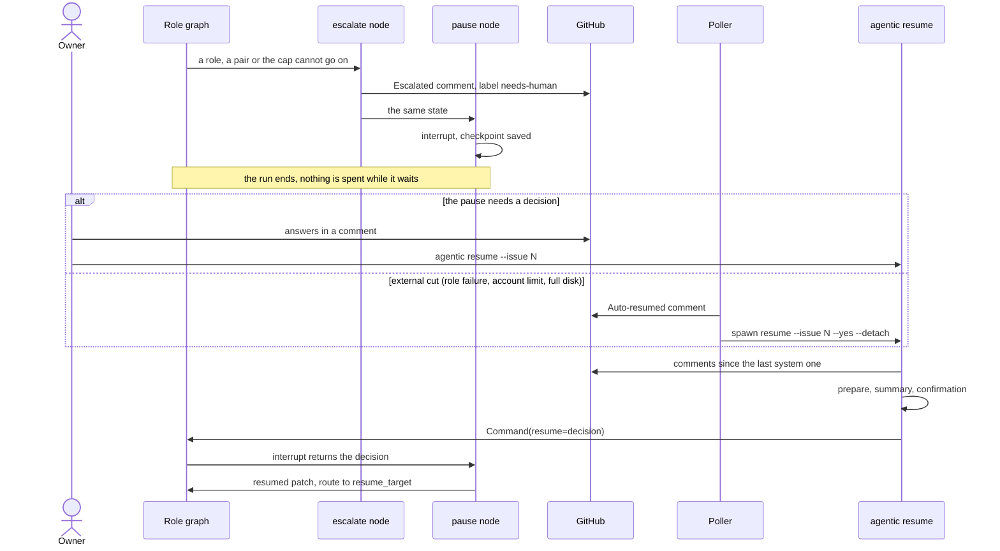

# Reanudación tras un escalado

Qué pasa cuando una tarea no puede seguir sin el humano o sin que pase algo externo, y cómo
vuelve a andar. Un Escalado y su Reanudación son términos del glosario de
`agentic/core/process/CONTEXT.md`; el mecanismo es `interrupt()` con
`Command(resume=...)` (ADR-0003, [interrupt para escalados](../../adr/0003-interrupt-para-escalados.md)).

## Paso por paso

1. **El escalado.** El caso de uso de un nodo deja el motivo en el estado; no pausa.
   `agentic/core/process/application/escalate.py:escalate` comenta el issue con el prefijo
   `Escalated: ` (`agentic/core/process/application/escalate.py:ESCALATED`), pone la etiqueta
   `needs-human` y guarda el documento.
2. **La pausa.** El nodo `pause` va después de `escalate` y no tiene efectos
   (`agentic/core/process/adapters/langgraph/graph.py:pause`). Ahí vive el `interrupt()`:
   LangGraph reanuda un nodo desde su comienzo, así que dentro de un caso de uso volvería a
   pagar el rol y dentro de `escalate` volvería a comentar el issue. La corrida termina con
   su estado en el checkpoint (`agentic/composition.py:checkpointer`).
3. **Quién reanuda.**
   - Si hace falta una decisión (preguntas abiertas, un par en su límite, una estimación que
     no cabe), la toma el dueño: comenta en el issue y corre `agentic resume --issue N`
     (`agentic/cli.py:_resume`).
   - Si el corte fue externo (un rol que falló por algo ajeno a la tarea, el límite de la
     cuenta, un disco lleno), el poller la retoma por su calendario:
     `agentic/core/process/application/poll.py:gather_resumes` evalúa cada pausa con
     `agentic/core/process/domain/rules.py:auto_resumable` y
     `agentic/core/process/domain/rules.py:next_attempt_at`, y `execute` lanza el hijo y deja
     el comentario `Auto-resumed: `
     (`agentic/core/process/application/poll.py:AUTO_RESUMED`). Si una persona habló después
     del sistema, la pausa ya es del humano y el poller no la toca.
4. **Antes de gastar.** `agentic/core/process/application/resume.py:prepare` decide la
   reanudación: toma como decisión todos los comentarios posteriores al último del sistema
   (`agentic/core/process/application/resume.py:human_decision`), se niega si el tope ya está
   gastado y devuelve una `Resumption`. `agentic/core/process/application/resume.py:summary`
   muestra la tarea, dónde se frenó, lo gastado y qué reanuda, y la CLI pide confirmación
   salvo con `--yes`.
5. **Retomar.** La CLI invoca el grafo con `Command(resume=...)`. `pause` devuelve el patch
   de reanudación (`agentic/core/process/domain/rules.py:resumed`) y el ruteo va a donde el
   estado dice que se frenó (`agentic/core/process/domain/rules.py:resume_target`).
6. **Si el estado guardado se perdió.** `agentic resume --issue N --from-document` siembra el
   estado desde el documento de la tarea, cruzado con git
   (`agentic/core/process/application/resume.py:from_document`), como si `escalate`
   acabara de correr.
