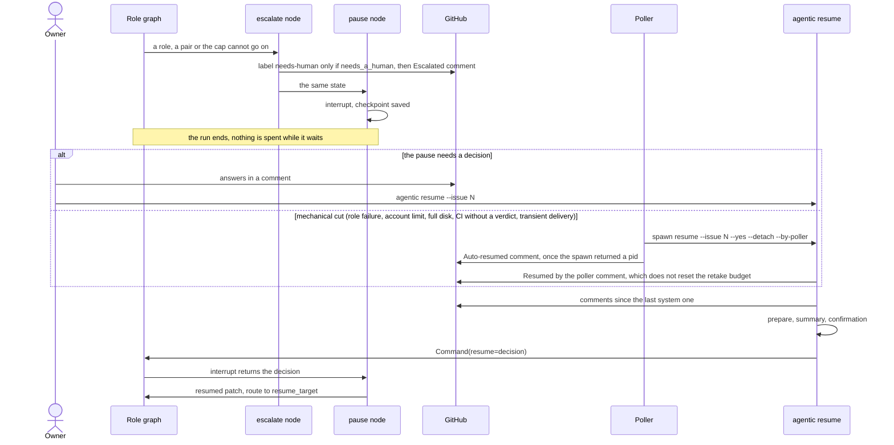

# Reanudación tras un escalado

Qué pasa cuando una tarea no puede seguir sin el humano o sin que pase algo externo, y cómo
vuelve a andar. Un Escalado y su Reanudación son términos del glosario de
`agentic/core/process/CONTEXT.md`; el mecanismo es `interrupt()` con
`Command(resume=...)` (ADR-0003, [interrupt para escalados](../../adr/0003-interrupt-para-escalados.md)).

## Paso por paso

1. **El escalado.** El caso de uso de un nodo deja el motivo en el estado; no pausa.
   `agentic/core/process/application/escalate.py:escalate`, en este orden, guarda el
   documento, pone la etiqueta `needs-human` solo si
   `agentic/core/process/domain/rules.py:needs_a_human` lo dice, y comenta el issue con el
   prefijo `Escalated: ` (`agentic/core/process/application/escalate.py:ESCALATED`). Una pausa
   causada solo por el límite de la cuenta, que el poller retoma sola, no lleva la etiqueta
   (glosario de `agentic/core/process/CONTEXT.md`).
2. **La pausa.** El nodo `pause` va después de `escalate` y no tiene efectos
   (`agentic/core/process/adapters/langgraph/graph.py:pause`). Ahí vive el `interrupt()`:
   LangGraph reanuda un nodo desde su comienzo, así que dentro de un caso de uso volvería a
   pagar el rol y dentro de `escalate` volvería a comentar el issue. La corrida termina con
   su estado en el checkpoint (`agentic/composition.py:checkpointer`).
3. **Quién reanuda.**
   - Si hace falta una decisión (preguntas abiertas, un par en su límite que ya no puede
     reiniciar, una estimación que no cabe), la toma el dueño: comenta en el issue y corre
     `agentic resume --issue N` (`agentic/cli.py:_resume`). Un reinicio limpio pendiente
     (`restart_pending`) no es una decisión ni un desacuerdo: si la corrida se cortó entre el
     reinicio y el `develop` que lo termina, la rama de la subtarea puede faltar o haberse
     movido y la reanudación no lo lee como problema
     (`agentic/core/process/application/resume.py:disagreements`).
   - Si el corte fue mecánico (un rol que falló por algo ajeno a la tarea, el límite de la
     cuenta, un disco lleno, o una escalación con una `MechanicalCause` como un CI sin
     veredicto o una entrega transitoria del sistema), el poller la retoma por su calendario,
     con el tope de `agentic/core/process/domain/rules.py:auto_resume_limit` (tres retomas
     para una causa mecánica, `agentic/core/process/domain/rules.py:schedule_for`):
     `agentic/core/process/application/poll.py:gather_resumes` evalúa cada pausa con
     `agentic/core/process/domain/rules.py:auto_resumable` y
     `agentic/core/process/domain/rules.py:next_attempt_at`, y `execute` lanza el hijo y,
     recién cuando el spawn devolvió un pid, deja el comentario `Auto-resumed: `
     (`agentic/core/process/application/poll.py:AUTO_RESUMED`). Las corridas que murieron por un
     reinicio, una caída o una señal fuera de un apagado (SIGTERM, SIGHUP, SIGINT; solo
     `agentic stop` es una parada deliberada) las retoma también el poller
     (`agentic/core/process/application/poll.py:gather_retakes`). Todo hijo que el poller lanza
     lleva `--by-poller` (`agentic/core/process/application/poll.py:_spawn_resume`) y su
     reanudación comenta `Resumed by the poller: `
     (`agentic/core/process/domain/retakes.py:RESUMED_BY_POLLER`), que a diferencia del
     `Resumed: ` de una persona no reinicia el presupuesto de retomas. Cuando ese presupuesto
     se gasta (o un lock muerto del mismo arranque, o de arranque desconocido, sin marca de caída,
     cuyo documento quedó sin tocar 24 h), el poller pone la etiqueta `needs-human` y
     deja un único comentario `Retakes spent: `
     (`agentic/core/process/application/poll.py:_announce_spent`). Si una persona habló después
     del sistema, la pausa ya es del humano y el poller no la toca.
4. **Antes de gastar.** `agentic/core/process/application/resume.py:prepare` decide la
   reanudación: toma como decisión todos los comentarios posteriores al último del sistema
   (`agentic/core/process/application/resume.py:human_decision`), se niega si el tope ya está
   gastado y devuelve una `Resumption`. `agentic/core/process/application/resume.py:summary`
   muestra la tarea, dónde se frenó, lo gastado y qué reanuda, y la CLI pide confirmación
   salvo con `--yes`.
5. **Retomar.** La CLI invoca el grafo con `Command(resume=...)`. `pause` devuelve el patch
   de reanudación (`agentic/core/process/domain/rules.py:resumed`) y el ruteo va a donde el
   estado dice que se frenó (`agentic/core/process/domain/rules.py:resume_target`): una tarea
   ligera sin plan sigue a `plan` y no a `define`, y una promoción pendiente la manda primero a
   `define` o `diagnose` (`agentic/core/process/domain/rules.py:promotion_route`).
6. **Si el estado guardado se perdió.** `agentic resume --issue N --from-document` siembra el
   estado desde el documento de la tarea, cruzado con git
   (`agentic/core/process/application/resume.py:from_document`), como si `escalate`
   acabara de correr.
7. **Una pausa sobre ítems de tracker (GH-620).** Los ítems `human` que el plan deja al dueño
   los levanta el sistema tras la entrega como un escalado `questions` con `needs-human`
   (`agentic/core/process/domain/tracker_items.py:escalate_human`), y `tracker_human` guarda
   sus hashes. Mientras `agentic/core/process/domain/rules.py:tracker_item_pause` valga:
   - Una decisión en blanco no reanuda. El nodo `pause`
     (`agentic/core/process/adapters/langgraph/graph.py:_pause_node`) vuelve a llamar a
     `interrupt()` con el mismo contenido, y `agentic/core/process/application/resume.py:prepare`
     espera con el mensaje de preguntas abiertas.
   - Una tarea con pull request y una decisión no escrita en blanco se resuelve sin ningún nodo
     del grafo: `prepare` devuelve una `Resumption` con `settled`, y
     `agentic/cli.py:_resume` llama a `agentic/core/process/application/resume.py:settle`, que
     guarda el patch de `agentic/core/process/domain/rules.py:resumed` (la única función que
     escribe `answered` en `tracker_actions_done`) y quita `needs-human`. El poller no la retoma:
     es una pausa humana.
   - `agentic/core/process/application/landing_plan.py:release` no libera la tarea mientras
     `tracker_human` no esté vacío, aunque haya un escalado de CI en el mismo head.
