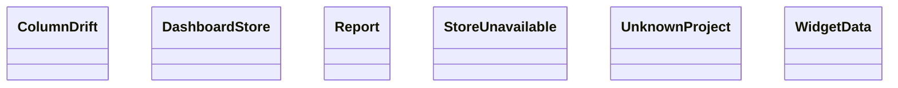

Esta página muestra las clases públicas de todos los módulos de `agentic.core.measurement.application` y sus relaciones (herencia, composición, agregación y asociación); las relaciones con clases de otras páginas no se dibujan y se listan debajo del diagrama. Cada clase se identifica por su módulo y su nombre: si dos clases de la página se llaman igual, la etiqueta incluye el módulo.

- Padre: [Clases de application](classes-measurement-application.md)

