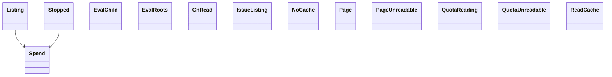

Esta página muestra las clases públicas de los módulos del grupo `ports` de `agentic.core.measurement.application` y sus relaciones (herencia, composición, agregación y asociación); las relaciones con clases de otras páginas no se dibujan y se listan debajo del diagrama. Cada clase se identifica por su módulo y su nombre: si dos clases de la página se llaman igual, la etiqueta incluye el módulo.

- Padre: [Clases de application](classes-measurement-application.md)
- Hermanas:
  - [application: commands](classes-measurement-application-commands.md)

## Relaciones con otras páginas

- [application: commands](classes-measurement-application-commands.md)
  - `eval_commands.Launched` se asocia con `ports.EvalChild`
