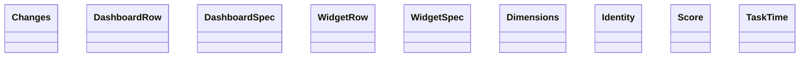

Esta página muestra las clases públicas de los módulos del grupo `langfuse` de `agentic.core.measurement.domain` y sus relaciones (herencia, composición, agregación y asociación); las relaciones con clases de otras páginas no se dibujan y se listan debajo del diagrama. Cada clase se identifica por su módulo y su nombre: si dos clases de la página se llaman igual, la etiqueta incluye el módulo.

- Padre: [Clases de domain](classes-measurement-domain.md)
- Hermanas:
  - [domain: reports](classes-measurement-domain-reports.md)
  - [domain: scorecard](classes-measurement-domain-scorecard.md)

