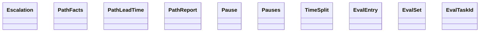

Esta página muestra las clases públicas de los módulos del grupo `scorecard` de `agentic.core.measurement.domain` y sus relaciones (herencia, composición, agregación y asociación); las relaciones con clases de otras páginas no se dibujan y se listan debajo del diagrama. Cada clase se identifica por su módulo y su nombre: si dos clases de la página se llaman igual, la etiqueta incluye el módulo. El grupo se dividió por cantidad: esta es la parte 1 de 2, con las clases en orden alfabético por módulo y clase.

- Padre: [Clases de domain](classes-measurement-domain.md)
- Hermanas:
  - [domain: langfuse](classes-measurement-domain-langfuse.md)
  - [domain: reports](classes-measurement-domain-reports.md)
  - [domain: scorecard (parte 2)](classes-measurement-domain-scorecard-2.md)

## Relaciones con otras páginas

- [domain: scorecard (parte 2)](classes-measurement-domain-scorecard-2.md)
  - `scorecard.TaskFigures` se asocia con `cycle.PathFacts`
