Esta página muestra las clases públicas de los módulos del grupo `filesystem` de `agentic.core.process.adapters` y sus relaciones (herencia, composición, agregación y asociación); las relaciones con clases de otras páginas no se dibujan y se listan debajo del diagrama. Cada clase se identifica por su módulo y su nombre: si dos clases de la página se llaman igual, la etiqueta incluye el módulo. El grupo se dividió por cantidad: esta es la parte 1 de 2, con las clases en orden alfabético por módulo y clase.

- Padre: [Clases de adapters](classes-process-adapters.md)
- Hermanas:
  - [adapters: claude_sdk](classes-process-adapters-claude_sdk.md)
  - [adapters: filesystem (parte 2)](classes-process-adapters-filesystem-2.md)
  - [adapters: git](classes-process-adapters-git.md)
  - [adapters: github](classes-process-adapters-github.md)
  - [adapters: shell](classes-process-adapters-shell.md)
  - [adapters: toplevel](classes-process-adapters-toplevel.md)

```mermaid
classDiagram
    class filesystem__board_sent__FilesystemBoardSent["FilesystemBoardSent"]
    class filesystem__check_ledger__FilesystemCheckLedger["FilesystemCheckLedger"]
    class filesystem__check_results__FilesystemCheckResults["FilesystemCheckResults"]
    class filesystem__documents__FilesystemTaskDocuments["FilesystemTaskDocuments"]
    class filesystem__experiment_file__FilesystemExperimentFile["FilesystemExperimentFile"]
    class filesystem__file_inbox__FileInbox["FileInbox"]
    class filesystem__free_space__StatvfsFreeSpace["StatvfsFreeSpace"]
    class filesystem__heartbeats__FilesystemHeartbeats["FilesystemHeartbeats"]
    class filesystem__installed_products__SystemdUnitInstalledProducts["SystemdUnitInstalledProducts"]
```

