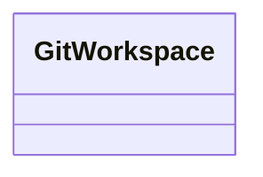

Esta página muestra las clases públicas de los módulos del grupo `git` de `agentic.core.process.adapters` y sus relaciones (herencia, composición, agregación y asociación); las relaciones con clases de otras páginas no se dibujan y se listan debajo del diagrama. Cada clase se identifica por su módulo y su nombre: si dos clases de la página se llaman igual, la etiqueta incluye el módulo.

- Padre: [Clases de adapters](classes-process-adapters.md)
- Hermanas:
  - [adapters: claude_sdk](classes-process-adapters-claude_sdk.md)
  - [adapters: filesystem](classes-process-adapters-filesystem.md)
  - [adapters: github](classes-process-adapters-github.md)
  - [adapters: shell](classes-process-adapters-shell.md)
  - [adapters: toplevel](classes-process-adapters-toplevel.md)

