Esta página muestra las clases públicas de los módulos del grupo `lifecycle` de `agentic.core.process.application` y sus relaciones (herencia, composición, agregación y asociación); las relaciones con clases de otras páginas no se dibujan y se listan debajo del diagrama. Cada clase se identifica por su módulo y su nombre: si dos clases de la página se llaman igual, la etiqueta incluye el módulo.

- Padre: [Clases de application](classes-process-application.md)
- Hermanas:
  - [application: checks](classes-process-application-checks.md)
  - [application: definition](classes-process-application-definition.md)
  - [application: landing](classes-process-application-landing.md)
  - [application: reflection](classes-process-application-reflection.md)
  - [application: support (parte 1)](classes-process-application-support-1.md)
  - [application: support (parte 2)](classes-process-application-support-2.md)
  - [application: support (parte 3)](classes-process-application-support-3.md)
  - [application: support (parte 4)](classes-process-application-support-4.md)
  - [application: support (parte 5)](classes-process-application-support-5.md)

```mermaid
classDiagram
    class archive__ArchiveResult["ArchiveResult"]
    class poll__Abandoned["Abandoned"]
    class poll__CrashRetake["CrashRetake"]
    class poll__MergeAssessment["MergeAssessment"]
    class poll__StackUnreadable["StackUnreadable"]
    class restore__RestoreResult["RestoreResult"]
    class resume__Increment["Increment"]
    class resume__Resumption["Resumption"]
    class resume__Seed["Seed"]
    class resume__WaitingOnHuman["WaitingOnHuman"]
    class schedule__FoldingDocuments["FoldingDocuments"]
```

