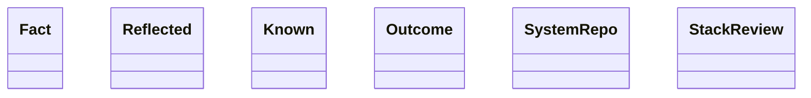

Esta página muestra las clases públicas de los módulos del grupo `reflection` de `agentic.core.process.application` y sus relaciones (herencia, composición, agregación y asociación); las relaciones con clases de otras páginas no se dibujan y se listan debajo del diagrama. Cada clase se identifica por su módulo y su nombre: si dos clases de la página se llaman igual, la etiqueta incluye el módulo.

- Padre: [Clases de application](classes-process-application.md)
- Hermanas:
  - [application: checks](classes-process-application-checks.md)
  - [application: definition](classes-process-application-definition.md)
  - [application: landing](classes-process-application-landing.md)
  - [application: lifecycle](classes-process-application-lifecycle.md)
  - [application: support (parte 1)](classes-process-application-support-1.md)
  - [application: support (parte 2)](classes-process-application-support-2.md)
  - [application: support (parte 3)](classes-process-application-support-3.md)
  - [application: support (parte 4)](classes-process-application-support-4.md)
  - [application: support (parte 5)](classes-process-application-support-5.md)
  - [application: support (parte 6)](classes-process-application-support-6.md)

## Relaciones con otras páginas

- [application: support (parte 2)](classes-process-application-support-2.md)
  - `reflect_run.SystemRepo` se asocia con `ports.Inbox`
- [application: support (parte 5)](classes-process-application-support-5.md)
  - `reflect_run.SystemRepo` se asocia con `ports.Tracker`
