Esta página muestra las clases públicas de los módulos del grupo `support` de `agentic.core.process.application` y sus relaciones (herencia, composición, agregación y asociación); las relaciones con clases de otras páginas no se dibujan y se listan debajo del diagrama. Cada clase se identifica por su módulo y su nombre: si dos clases de la página se llaman igual, la etiqueta incluye el módulo. El grupo se dividió por cantidad: esta es la parte 2 de 7, con las clases en orden alfabético por módulo y clase.

- Padre: [Clases de application](classes-process-application.md)
- Hermanas:
  - [application: build](classes-process-application-build.md)
  - [application: checks](classes-process-application-checks.md)
  - [application: definition](classes-process-application-definition.md)
  - [application: landing](classes-process-application-landing.md)
  - [application: lifecycle (parte 1)](classes-process-application-lifecycle-1.md)
  - [application: lifecycle (parte 2)](classes-process-application-lifecycle-2.md)
  - [application: reflection](classes-process-application-reflection.md)
  - [application: support (parte 1)](classes-process-application-support-1.md)
  - [application: support (parte 3)](classes-process-application-support-3.md)
  - [application: support (parte 4)](classes-process-application-support-4.md)
  - [application: support (parte 5)](classes-process-application-support-5.md)
  - [application: support (parte 6)](classes-process-application-support-6.md)
  - [application: support (parte 7)](classes-process-application-support-7.md)

```mermaid
classDiagram
    class ports__CheckRuns["CheckRuns"]
    class ports__CheckScheduler["CheckScheduler"]
    class ports__CheckTool["CheckTool"]
    class ports__Checkout["Checkout"]
    class ports__CiLogs["CiLogs"]
    class ports__CommandResult["CommandResult"]
    class ports__Commands["Commands"]
    class ports__CommitCiReader["CommitCiReader"]
    class ports__ExperimentFile["ExperimentFile"]
    class ports__FailurePolicy["FailurePolicy"]
    class ports__FastForwardView["FastForwardView"]
    class ports__FlagVocabulary["FlagVocabulary"]
    class ports__FreeSpace["FreeSpace"]
    class ports__GitError["GitError"]
```

## Relaciones con otras páginas

- [application: support (parte 1)](classes-process-application-support-1.md)
  - `ci_push.PushFailed` hereda de `ports.GitError`
  - `ports.AttemptFailed` se asocia con `ports.CheckRuns`
- [application: support (parte 4)](classes-process-application-support-4.md)
  - `ports.Ports` se asocia con `ports.CheckScheduler`
  - `ports.Ports` se asocia con `ports.Commands`
  - `ports.Ports` se asocia con `ports.FlagVocabulary`
  - `ports.RawResult` se asocia con `ports.CheckRuns`
  - `ports.RemergeDiffUnsupported` hereda de `ports.GitError`
- [application: support (parte 7)](classes-process-application-support-7.md)
  - `ports.UnstageablePath` hereda de `ports.GitError`
  - `run_role.Output` se asocia con `ports.CheckRuns`
