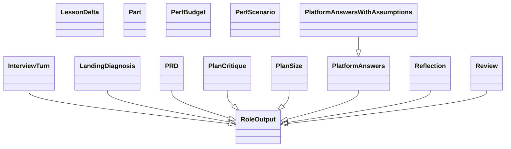

Esta página muestra las clases públicas de los módulos del grupo `roles` de `agentic.core.process.domain` y sus relaciones (herencia, composición, agregación y asociación); las relaciones con clases de otras páginas no se dibujan y se listan debajo del diagrama. Cada clase se identifica por su módulo y su nombre: si dos clases de la página se llaman igual, la etiqueta incluye el módulo. El grupo se dividió por cantidad: esta es la parte 4 de 5, con las clases en orden alfabético por módulo y clase.

- Padre: [Clases de domain](classes-process-domain.md)
- Hermanas:
  - [domain: checks (parte 1)](classes-process-domain-checks-1.md)
  - [domain: checks (parte 2)](classes-process-domain-checks-2.md)
  - [domain: checks (parte 3)](classes-process-domain-checks-3.md)
  - [domain: checks (parte 4)](classes-process-domain-checks-4.md)
  - [domain: landing (parte 1)](classes-process-domain-landing-1.md)
  - [domain: landing (parte 2)](classes-process-domain-landing-2.md)
  - [domain: landing (parte 3)](classes-process-domain-landing-3.md)
  - [domain: machine (parte 1)](classes-process-domain-machine-1.md)
  - [domain: machine (parte 2)](classes-process-domain-machine-2.md)
  - [domain: machine (parte 3)](classes-process-domain-machine-3.md)
  - [domain: playbook (parte 1)](classes-process-domain-playbook-1.md)
  - [domain: playbook (parte 2)](classes-process-domain-playbook-2.md)
  - [domain: roles (parte 1)](classes-process-domain-roles-1.md)
  - [domain: roles (parte 2)](classes-process-domain-roles-2.md)
  - [domain: roles (parte 3)](classes-process-domain-roles-3.md)
  - [domain: roles (parte 5)](classes-process-domain-roles-5.md)
  - [domain: state (parte 1)](classes-process-domain-state-1.md)
  - [domain: state (parte 10)](classes-process-domain-state-10.md)
  - [domain: state (parte 2)](classes-process-domain-state-2.md)
  - [domain: state (parte 3)](classes-process-domain-state-3.md)
  - [domain: state (parte 4)](classes-process-domain-state-4.md)
  - [domain: state (parte 5)](classes-process-domain-state-5.md)
  - [domain: state (parte 6)](classes-process-domain-state-6.md)
  - [domain: state (parte 7)](classes-process-domain-state-7.md)
  - [domain: state (parte 8)](classes-process-domain-state-8.md)
  - [domain: state (parte 9)](classes-process-domain-state-9.md)

## Relaciones con otras páginas

- [domain: roles (parte 2)](classes-process-domain-roles-2.md)
  - `schemas.Answers` hereda de `schemas.RoleOutput`
  - `schemas.CarveOutOutput` hereda de `schemas.RoleOutput`
  - `schemas.Classification` hereda de `schemas.RoleOutput`
  - `schemas.Consolidation` hereda de `schemas.RoleOutput`
  - `schemas.Consultation` hereda de `schemas.RoleOutput`
  - `schemas.CopyDraft` hereda de `schemas.RoleOutput`
  - `schemas.CopyReview` hereda de `schemas.RoleOutput`
  - `schemas.DefinitionTurn` hereda de `schemas.InterviewTurn`
- [domain: roles (parte 3)](classes-process-domain-roles-3.md)
  - `schemas.Delivery` hereda de `schemas.RoleOutput`
  - `schemas.DesignDraft` hereda de `schemas.RoleOutput`
  - `schemas.DesignReview` hereda de `schemas.RoleOutput`
  - `schemas.Diagnosis` hereda de `schemas.RoleOutput`
  - `schemas.FinalValidation` hereda de `schemas.RoleOutput`
- [domain: roles (parte 5)](classes-process-domain-roles-5.md)
  - `schemas.Ruling` hereda de `schemas.RoleOutput`
  - `schemas.SolutionTurn` hereda de `schemas.InterviewTurn`
  - `schemas.StackProposal` hereda de `schemas.RoleOutput`
  - `schemas.TechAnswers` hereda de `schemas.RoleOutput`
  - `schemas.TechPlan` hereda de `schemas.RoleOutput`
  - `schemas.Verdict` hereda de `schemas.RoleOutput`
