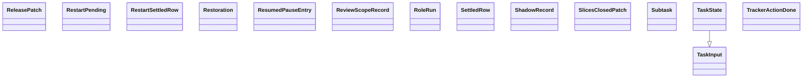

Esta página muestra las clases públicas de los módulos del grupo `state` de `agentic.core.process.domain` y sus relaciones (herencia, composición, agregación y asociación); las relaciones con clases de otras páginas no se dibujan y se listan debajo del diagrama. Cada clase se identifica por su módulo y su nombre: si dos clases de la página se llaman igual, la etiqueta incluye el módulo. El grupo se dividió por cantidad: esta es la parte 7 de 8, con las clases en orden alfabético por módulo y clase.

- Padre: [Clases de domain](classes-process-domain.md)
- Hermanas:
  - [domain: checks (parte 1)](classes-process-domain-checks-1.md)
  - [domain: checks (parte 2)](classes-process-domain-checks-2.md)
  - [domain: checks (parte 3)](classes-process-domain-checks-3.md)
  - [domain: checks (parte 4)](classes-process-domain-checks-4.md)
  - [domain: landing (parte 1)](classes-process-domain-landing-1.md)
  - [domain: landing (parte 2)](classes-process-domain-landing-2.md)
  - [domain: landing (parte 3)](classes-process-domain-landing-3.md)
  - [domain: machine (parte 1)](classes-process-domain-machine-1.md)
  - [domain: machine (parte 2)](classes-process-domain-machine-2.md)
  - [domain: machine (parte 3)](classes-process-domain-machine-3.md)
  - [domain: playbook](classes-process-domain-playbook.md)
  - [domain: roles (parte 1)](classes-process-domain-roles-1.md)
  - [domain: roles (parte 2)](classes-process-domain-roles-2.md)
  - [domain: roles (parte 3)](classes-process-domain-roles-3.md)
  - [domain: roles (parte 4)](classes-process-domain-roles-4.md)
  - [domain: state (parte 1)](classes-process-domain-state-1.md)
  - [domain: state (parte 2)](classes-process-domain-state-2.md)
  - [domain: state (parte 3)](classes-process-domain-state-3.md)
  - [domain: state (parte 4)](classes-process-domain-state-4.md)
  - [domain: state (parte 5)](classes-process-domain-state-5.md)
  - [domain: state (parte 6)](classes-process-domain-state-6.md)
  - [domain: state (parte 8)](classes-process-domain-state-8.md)

## Relaciones con otras páginas

- [domain: landing (parte 2)](classes-process-domain-landing-2.md)
  - `landing.ApiBreakAnswer` se asocia con `task.ReleasePatch`
- [domain: state (parte 3)](classes-process-domain-state-3.md)
  - `task.TaskState` se asocia con `task.ArmAssignment`
- [domain: state (parte 4)](classes-process-domain-state-4.md)
  - `task.TaskState` se asocia con `task.EvaluationRef`
- [domain: state (parte 5)](classes-process-domain-state-5.md)
  - `task.TaskState` se asocia con `task.FullChecksRecord`
  - `task.TaskState` se asocia con `task.InterviewStats`
- [domain: state (parte 6)](classes-process-domain-state-6.md)
  - `task.TaskState` se asocia con `task.PlanRoute`
- [domain: state (parte 8)](classes-process-domain-state-8.md)
  - `task.Subtask` se asocia con `task_path.PromoteRequest`
  - `task.TaskState` se asocia con `task_path.Promotion`
