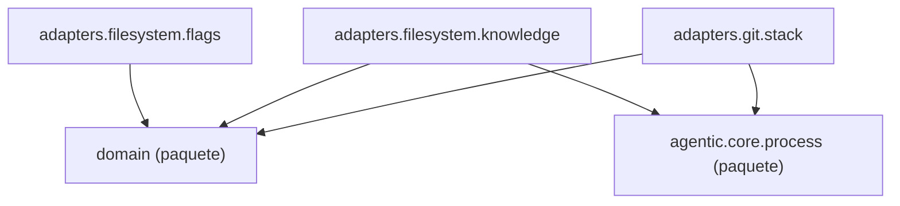

Esta página muestra los módulos de la capa `adapters` de `agentic.core.knowledge` y los imports que hacen; un nodo `<nombre> (paquete)` es otra capa del paquete o un paquete de fuera, que no se detalla aquí.

- Padre: [Paquetes de knowledge](packages-knowledge.md)
- Hermanas:
  - [knowledge: domain](packages-knowledge-domain.md)

