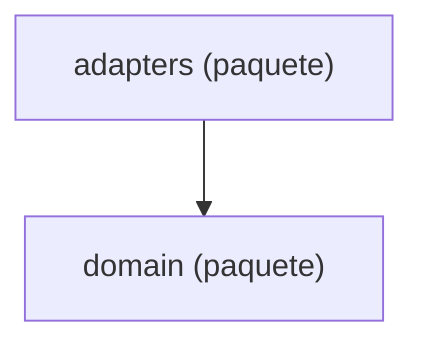

Esta página muestra las capas de `agentic.core.knowledge` (`domain`, `adapters`), con una flecha por cada capa que importa a otra. Cada capa tiene su página, con sus módulos y los imports que hacen.

- Páginas:
  - [knowledge: domain](packages-knowledge-domain.md)
  - [knowledge: adapters](packages-knowledge-adapters.md)

