Esta página muestra los módulos de la capa `adapters` de `agentic.core.measurement` y los imports que hacen; un nodo `<nombre> (paquete)` es otra capa del paquete o un paquete de fuera, que no se detalla aquí.

- Padre: [Paquetes de measurement](packages-measurement.md)
- Hermanas:
  - [measurement: application](packages-measurement-application.md)
  - [measurement: domain (1)](packages-measurement-domain-1.md)
  - [measurement: domain (2)](packages-measurement-domain-2.md)

```mermaid
graph TD
    g_pkg__agentic__core__process["agentic.core.process (paquete)"]
    g_pkg__agentic__shared["agentic.shared (paquete)"]
    g_pkg__application["application (paquete)"]
    g_pkg__domain["domain (paquete)"]
    m_adapters__filesystem__read_cache["adapters.filesystem.read_cache"]
    m_adapters__git__eval_roots["adapters.git.eval_roots"]
    m_adapters__github__issue_listing["adapters.github.issue_listing"]
    m_adapters__langfuse__dashboards["adapters.langfuse.dashboards"]
    m_adapters__langfuse__scores["adapters.langfuse.scores"]
    m_adapters__langfuse__widget_data["adapters.langfuse.widget_data"]
    m_adapters__otel__semconv["adapters.otel.semconv"]
    m_adapters__otel__telemetry["adapters.otel.telemetry"]
    m_adapters__filesystem__read_cache --> g_pkg__domain
    m_adapters__git__eval_roots --> g_pkg__agentic__core__process
    m_adapters__github__issue_listing --> g_pkg__agentic__core__process
    m_adapters__github__issue_listing --> g_pkg__application
    m_adapters__github__issue_listing --> g_pkg__domain
    m_adapters__langfuse__dashboards --> g_pkg__application
    m_adapters__langfuse__dashboards --> g_pkg__domain
    m_adapters__langfuse__scores --> g_pkg__domain
    m_adapters__langfuse__widget_data --> g_pkg__domain
    m_adapters__otel__telemetry --> g_pkg__agentic__core__process
    m_adapters__otel__telemetry --> g_pkg__agentic__shared
    m_adapters__otel__telemetry --> g_pkg__domain
    m_adapters__otel__telemetry --> m_adapters__otel__semconv
```

