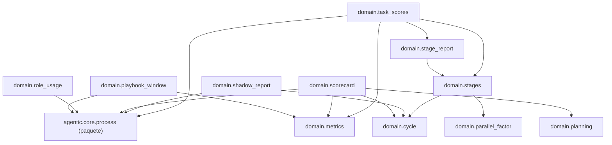

Esta página muestra los módulos de la capa `domain` de `agentic.core.measurement` y los imports que hacen; un nodo `<nombre> (paquete)` es otra capa del paquete o un paquete de fuera, que no se detalla aquí. La capa no cabe en un diagrama: está partida en tandas de módulos consecutivos, y un módulo de otra tanda aparece como nodo sin sus imports.

- Padre: [Paquetes de measurement](packages-measurement.md)
- Hermanas:
  - [measurement: adapters](packages-measurement-adapters.md)
  - [measurement: application](packages-measurement-application.md)
  - [measurement: domain (1)](packages-measurement-domain-1.md)

