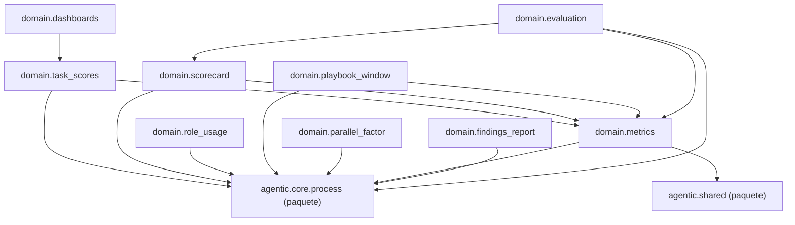

Esta página muestra los módulos de la capa `domain` de `agentic.core.measurement` y los imports que hacen; un nodo `<nombre> (paquete)` es otra capa del paquete o un paquete de fuera, que no se detalla aquí.

- Padre: [Paquetes de measurement](packages-measurement.md)
- Hermanas:
  - [measurement: adapters](packages-measurement-adapters.md)
  - [measurement: application](packages-measurement-application.md)

