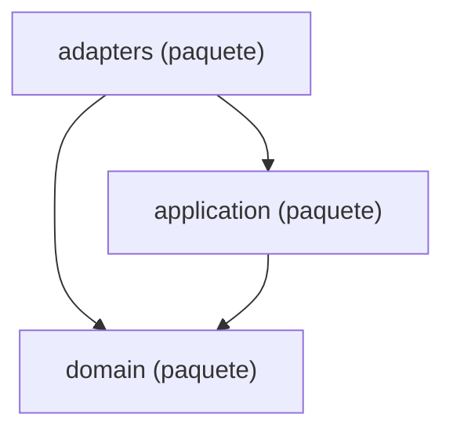

Esta página muestra las capas de `agentic.core.measurement` (`domain`, `application`, `adapters`), con una flecha por cada capa que importa a otra. Cada capa tiene su página, con sus módulos y los imports que hacen.

- Páginas:
  - [measurement: domain](packages-measurement-domain.md)
  - [measurement: application](packages-measurement-application.md)
  - [measurement: adapters](packages-measurement-adapters.md)

