Esta página muestra los módulos del adaptador `adapters.filesystem` y los imports que hacen; un nodo `<nombre> (paquete)` es otro paquete: con su página si es un paquete de `process`, sin ella si es de fuera. El adaptador se dividió por cantidad: esta es la parte 1 de 2, con módulos consecutivos en orden alfabético; un import de un módulo de otra parte aparece como el nodo `adapters.filesystem (paquete)`.

- Padre: [Paquetes de process](packages-process.md)
- Hermanas:
  - [adapters.claude_sdk](packages-process-adapters-claude_sdk.md)
  - [adapters.filesystem (parte 2)](packages-process-adapters-filesystem-2.md)
  - [adapters.git](packages-process-adapters-git.md)
  - [adapters.github](packages-process-adapters-github.md)
  - [adapters.langgraph](packages-process-adapters-langgraph.md)
  - [adapters.shell](packages-process-adapters-shell.md)
  - [adapters.smtp](packages-process-adapters-smtp.md)
  - [adapters](packages-process-adapters.md)
  - [application](packages-process-application.md)
  - [domain](packages-process-domain.md)

```mermaid
graph TD
    g_pkg__adapters["adapters (paquete)"]
    g_pkg__adapters__filesystem["adapters.filesystem (paquete)"]
    g_pkg__application["application (paquete)"]
    g_pkg__domain["domain (paquete)"]
    m_adapters__filesystem__board_sent["adapters.filesystem.board_sent"]
    m_adapters__filesystem__budget_store["adapters.filesystem.budget_store"]
    m_adapters__filesystem__check_ledger["adapters.filesystem.check_ledger"]
    m_adapters__filesystem__check_results["adapters.filesystem.check_results"]
    m_adapters__filesystem__documents["adapters.filesystem.documents"]
    m_adapters__filesystem__experiment_file["adapters.filesystem.experiment_file"]
    m_adapters__filesystem__file_inbox["adapters.filesystem.file_inbox"]
    m_adapters__filesystem__free_space["adapters.filesystem.free_space"]
    m_adapters__filesystem__github_cache["adapters.filesystem.github_cache"]
    m_adapters__filesystem__heartbeats["adapters.filesystem.heartbeats"]
    m_adapters__filesystem__installed_products["adapters.filesystem.installed_products"]
    m_adapters__filesystem__board_sent --> g_pkg__application
    m_adapters__filesystem__board_sent --> g_pkg__domain
    m_adapters__filesystem__budget_store --> g_pkg__domain
    m_adapters__filesystem__check_ledger --> g_pkg__adapters__filesystem
    m_adapters__filesystem__check_ledger --> g_pkg__application
    m_adapters__filesystem__check_ledger --> g_pkg__domain
    m_adapters__filesystem__check_results --> g_pkg__domain
    m_adapters__filesystem__documents --> g_pkg__adapters
    m_adapters__filesystem__documents --> g_pkg__domain
    m_adapters__filesystem__file_inbox --> g_pkg__domain
    m_adapters__filesystem__free_space --> g_pkg__domain
    m_adapters__filesystem__github_cache --> g_pkg__domain
    m_adapters__filesystem__heartbeats --> g_pkg__domain
    m_adapters__filesystem__installed_products --> g_pkg__domain
```

