Esta página muestra la parte 2 de 2 de los módulos del adaptador `adapters.filesystem`, con módulos consecutivos en orden alfabético, y los imports que hacen; un nodo `<nombre> parte <n> (grupo)` es otra parte del adaptador y `<nombre> (paquete)` otro paquete: con su página si es un paquete de `process`, sin ella si es de fuera.

- Padre: [adapters.filesystem](packages-process-adapters-filesystem.md)
- Hermanas:
  - [adapters.filesystem (parte 1)](packages-process-adapters-filesystem-1.md)

```mermaid
graph TD
    g_pkg__application["application (paquete)"]
    g_pkg__domain["domain (paquete)"]
    m_adapters__filesystem__installed_products["adapters.filesystem.installed_products"]
    m_adapters__filesystem__liveness["adapters.filesystem.liveness"]
    m_adapters__filesystem__lock["adapters.filesystem.lock"]
    m_adapters__filesystem__perf_lock["adapters.filesystem.perf_lock"]
    m_adapters__filesystem__prompts["adapters.filesystem.prompts"]
    m_adapters__filesystem__run_registry["adapters.filesystem.run_registry"]
    m_adapters__filesystem__scratch["adapters.filesystem.scratch"]
    m_adapters__filesystem__stage0_store["adapters.filesystem.stage0_store"]
    m_adapters__filesystem__stage0_users["adapters.filesystem.stage0_users"]
    m_adapters__filesystem__installed_products --> g_pkg__domain
    m_adapters__filesystem__liveness --> g_pkg__application
    m_adapters__filesystem__liveness --> g_pkg__domain
    m_adapters__filesystem__lock --> g_pkg__application
    m_adapters__filesystem__lock --> m_adapters__filesystem__liveness
    m_adapters__filesystem__perf_lock --> g_pkg__application
    m_adapters__filesystem__perf_lock --> m_adapters__filesystem__liveness
    m_adapters__filesystem__prompts --> g_pkg__domain
    m_adapters__filesystem__run_registry --> g_pkg__application
    m_adapters__filesystem__run_registry --> g_pkg__domain
    m_adapters__filesystem__run_registry --> m_adapters__filesystem__liveness
    m_adapters__filesystem__scratch --> g_pkg__domain
    m_adapters__filesystem__scratch --> m_adapters__filesystem__liveness
    m_adapters__filesystem__stage0_store --> g_pkg__domain
    m_adapters__filesystem__stage0_users --> g_pkg__domain
```

