Esta página muestra los módulos del adaptador `adapters.filesystem` y los imports que hacen; un nodo `<nombre> (paquete)` es otro paquete: con su página si es un paquete de `process`, sin ella si es de fuera. El tipo no cabe en un diagrama: está partido en tandas de módulos consecutivos, y un módulo de otra tanda aparece como nodo sin sus imports.

- Padre: [Paquetes de process](packages-process.md)
- Hermanas:
  - [adapters.claude_sdk](packages-process-adapters-claude_sdk.md)
  - [adapters.filesystem (parte 1)](packages-process-adapters-filesystem-1.md)
  - [adapters.git](packages-process-adapters-git.md)
  - [adapters.github](packages-process-adapters-github.md)
  - [adapters.langgraph](packages-process-adapters-langgraph.md)
  - [adapters.shell](packages-process-adapters-shell.md)
  - [adapters](packages-process-adapters.md)
  - [application](packages-process-application.md)
  - [domain](packages-process-domain.md)

```mermaid
graph TD
    g_pkg__application["application (paquete)"]
    g_pkg__domain["domain (paquete)"]
    m_adapters__filesystem__liveness["adapters.filesystem.liveness"]
    m_adapters__filesystem__lock["adapters.filesystem.lock"]
    m_adapters__filesystem__perf_lock["adapters.filesystem.perf_lock"]
    m_adapters__filesystem__prompts["adapters.filesystem.prompts"]
    m_adapters__filesystem__run_registry["adapters.filesystem.run_registry"]
    m_adapters__filesystem__scratch["adapters.filesystem.scratch"]
    m_adapters__filesystem__stage0_store["adapters.filesystem.stage0_store"]
    m_adapters__filesystem__stage0_users["adapters.filesystem.stage0_users"]
    m_adapters__filesystem__write_gate["adapters.filesystem.write_gate"]
    m_adapters__filesystem__liveness --> g_pkg__application
    m_adapters__filesystem__liveness --> g_pkg__domain
    m_adapters__filesystem__lock --> g_pkg__application
    m_adapters__filesystem__lock --> m_adapters__filesystem__liveness
    m_adapters__filesystem__perf_lock --> g_pkg__application
    m_adapters__filesystem__perf_lock --> m_adapters__filesystem__liveness
    m_adapters__filesystem__prompts --> g_pkg__domain
    m_adapters__filesystem__run_registry --> g_pkg__application
    m_adapters__filesystem__run_registry --> g_pkg__domain
    m_adapters__filesystem__run_registry --> m_adapters__filesystem__liveness
    m_adapters__filesystem__scratch --> g_pkg__domain
    m_adapters__filesystem__scratch --> m_adapters__filesystem__liveness
    m_adapters__filesystem__stage0_store --> g_pkg__domain
    m_adapters__filesystem__stage0_users --> g_pkg__domain
    m_adapters__filesystem__write_gate --> g_pkg__application
    m_adapters__filesystem__write_gate --> g_pkg__domain
```

