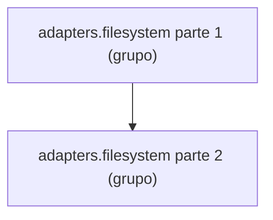

Esta página muestra las partes en que se dividieron los módulos del adaptador `adapters.filesystem` por cantidad, y una flecha por cada parte que importa módulos de otra; cada nodo `<nombre> parte <n> (grupo)` tiene su página, con los módulos consecutivos en orden alfabético.

- Padre: [Paquetes de process](packages-process.md)
- Hermanas:
  - [adapters.claude_sdk](packages-process-adapters-claude_sdk.md)
  - [adapters.git](packages-process-adapters-git.md)
  - [adapters.github](packages-process-adapters-github.md)
  - [adapters.langgraph](packages-process-adapters-langgraph.md)
  - [adapters.shell](packages-process-adapters-shell.md)
  - [adapters](packages-process-adapters.md)
  - [application](packages-process-application.md)
  - [domain](packages-process-domain.md)
- Grupos:
  - [adapters.filesystem (parte 1)](packages-process-adapters-filesystem-1.md)
  - [adapters.filesystem (parte 2)](packages-process-adapters-filesystem-2.md)

