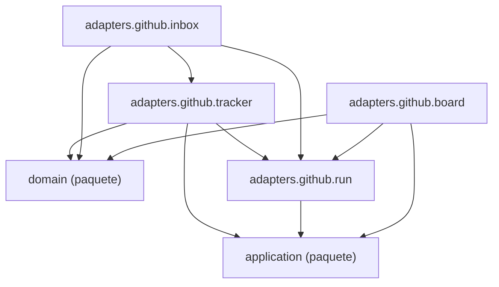

Esta página muestra los módulos del adaptador `adapters.github` y los imports que hacen; un nodo `<nombre> (paquete)` es otro paquete: con su página si es un paquete de `process`, sin ella si es de fuera (por ejemplo `agentic.shared`).

- Padre: [Paquetes de process](packages-process.md)
- Hermanas:
  - [adapters.claude_sdk](packages-process-adapters-claude_sdk.md)
  - [adapters.filesystem](packages-process-adapters-filesystem.md)
  - [adapters.git](packages-process-adapters-git.md)
  - [adapters.langgraph](packages-process-adapters-langgraph.md)
  - [adapters.shell](packages-process-adapters-shell.md)
  - [adapters](packages-process-adapters.md)
  - [application](packages-process-application.md)
  - [domain](packages-process-domain.md)

