Esta página muestra los módulos del grupo `landing` de `application` y los imports que hacen; un nodo `<nombre> (grupo)` es otro grupo de `application`, `<nombre> (grupo de domain)` un grupo de `domain` y `<nombre> (paquete)` otro paquete, cada uno con su página. Los imports hacia `domain` se resumen en un solo nodo `domain (paquete)` porque dibujar un nodo por grupo no cabe en el presupuesto de diagramas. El grupo se dividió por cantidad: esta es la parte 2 de 2, con módulos consecutivos en orden alfabético, y las otras partes aparecen como nodos `<grupo> parte <n> (grupo)`.

- Padre: [application](packages-process-application.md)
- Hermanas:
  - [application: build (parte 1)](packages-process-application-build-1.md)
  - [application: build (parte 2)](packages-process-application-build-2.md)
  - [application: checks](packages-process-application-checks.md)
  - [application: definition (parte 1)](packages-process-application-definition-1.md)
  - [application: definition (parte 2)](packages-process-application-definition-2.md)
  - [application: landing (parte 1)](packages-process-application-landing-1.md)
  - [application: lifecycle (parte 1)](packages-process-application-lifecycle-1.md)
  - [application: lifecycle (parte 2)](packages-process-application-lifecycle-2.md)
  - [application: reflection](packages-process-application-reflection.md)
  - [application: support](packages-process-application-support.md)

```mermaid
graph TD
    g_application__build["build (grupo)"]
    g_application__checks["checks (grupo)"]
    g_application__landing__1["landing parte 1 (grupo)"]
    g_application__lifecycle["lifecycle (grupo)"]
    g_application__support["support (grupo)"]
    g_pkg__agentic__shared["agentic.shared (paquete)"]
    g_pkg__domain["domain (paquete)"]
    m_application__landing_flakes["application.landing_flakes"]
    m_application__landing_plan["application.landing_plan"]
    m_application__landing_slice["application.landing_slice"]
    m_application__landing_sync["application.landing_sync"]
    m_application__merge["application.merge"]
    m_application__landing_flakes --> g_application__support
    m_application__landing_flakes --> g_pkg__domain
    m_application__landing_plan --> g_application__build
    m_application__landing_plan --> g_application__lifecycle
    m_application__landing_plan --> g_application__support
    m_application__landing_plan --> g_pkg__agentic__shared
    m_application__landing_plan --> g_pkg__domain
    m_application__landing_slice --> g_application__checks
    m_application__landing_slice --> g_application__lifecycle
    m_application__landing_slice --> g_application__support
    m_application__landing_slice --> g_pkg__domain
    m_application__landing_slice --> m_application__landing_plan
    m_application__landing_sync --> g_application__landing__1
    m_application__landing_sync --> g_application__lifecycle
    m_application__landing_sync --> g_application__support
    m_application__landing_sync --> g_pkg__domain
    m_application__landing_sync --> m_application__landing_plan
    m_application__merge --> g_application__build
    m_application__merge --> g_application__checks
    m_application__merge --> g_application__landing__1
    m_application__merge --> g_application__lifecycle
    m_application__merge --> g_application__support
    m_application__merge --> g_pkg__agentic__shared
    m_application__merge --> g_pkg__domain
    m_application__merge --> m_application__landing_flakes
    m_application__merge --> m_application__landing_plan
```

