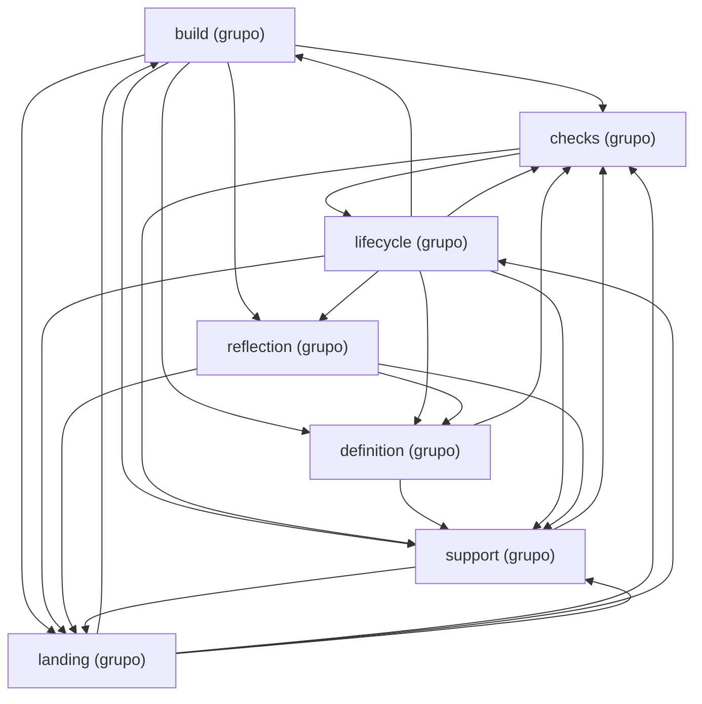

Esta página muestra los grupos de módulos de `application` y una flecha por cada grupo que importa módulos de otro; cada nodo `<nombre> (grupo)` tiene su página. Los imports hacia otros paquetes se leen en la página de cada grupo, y los grupos se definen en `CLUSTERS`, en `scripts/docs/groups.py`.

- Padre: [Paquetes de process](packages-process.md)
- Hermanas:
  - [adapters.claude_sdk](packages-process-adapters-claude_sdk.md)
  - [adapters.filesystem](packages-process-adapters-filesystem.md)
  - [adapters.git](packages-process-adapters-git.md)
  - [adapters.github](packages-process-adapters-github.md)
  - [adapters.langgraph](packages-process-adapters-langgraph.md)
  - [adapters.shell](packages-process-adapters-shell.md)
  - [adapters](packages-process-adapters.md)
  - [domain](packages-process-domain.md)
- Grupos:
  - [application: build (parte 1)](packages-process-application-build-1.md)
  - [application: build (parte 2)](packages-process-application-build-2.md)
  - [application: checks](packages-process-application-checks.md)
  - [application: definition (parte 1)](packages-process-application-definition-1.md)
  - [application: definition (parte 2)](packages-process-application-definition-2.md)
  - [application: landing (parte 1)](packages-process-application-landing-1.md)
  - [application: landing (parte 2)](packages-process-application-landing-2.md)
  - [application: lifecycle (parte 1)](packages-process-application-lifecycle-1.md)
  - [application: lifecycle (parte 2)](packages-process-application-lifecycle-2.md)
  - [application: reflection](packages-process-application-reflection.md)
  - [application: support](packages-process-application-support.md)

