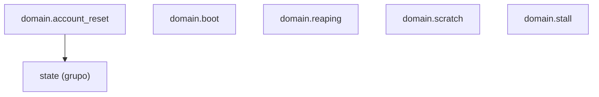

Esta página muestra los módulos del grupo `machine` de `domain` y los imports que hacen; un nodo `<nombre> (grupo)` es otro grupo de `domain`, `<nombre> (grupo de domain)` un grupo de `domain` y `<nombre> (paquete)` otro paquete, cada uno con su página.

- Padre: [domain](packages-process-domain.md)
- Hermanas:
  - [domain: checks](packages-process-domain-checks.md)
  - [domain: landing](packages-process-domain-landing.md)
  - [domain: playbook](packages-process-domain-playbook.md)
  - [domain: roles](packages-process-domain-roles.md)
  - [domain: state](packages-process-domain-state.md)

