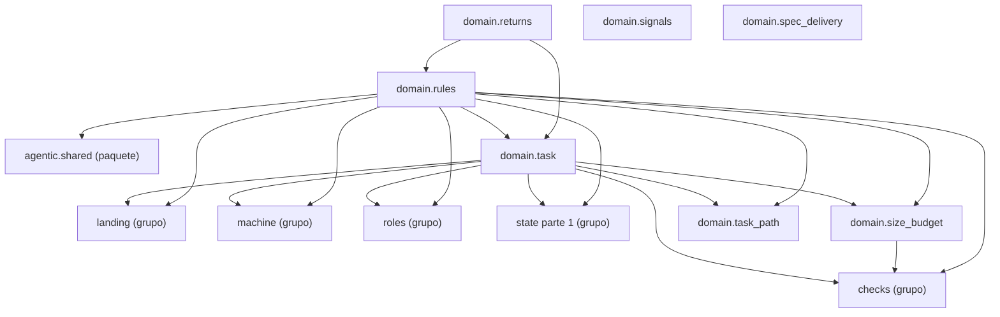

Esta página muestra los módulos del grupo `state` de `domain` y los imports que hacen; un nodo `<nombre> (grupo)` es otro grupo de `domain` (cada grupo tiene su página) y `<nombre> (paquete)` otro paquete: con su página si es un paquete de `process`, sin ella si es de fuera. El grupo se dividió por cantidad: esta es la parte 2 de 2, con módulos consecutivos en orden alfabético, y las otras partes aparecen como nodos `<grupo> parte <n> (grupo)`.

- Padre: [domain](packages-process-domain.md)
- Hermanas:
  - [domain: checks (parte 1)](packages-process-domain-checks-1.md)
  - [domain: checks (parte 2)](packages-process-domain-checks-2.md)
  - [domain: landing](packages-process-domain-landing.md)
  - [domain: machine](packages-process-domain-machine.md)
  - [domain: playbook](packages-process-domain-playbook.md)
  - [domain: roles](packages-process-domain-roles.md)
  - [domain: state (parte 1)](packages-process-domain-state-1.md)

