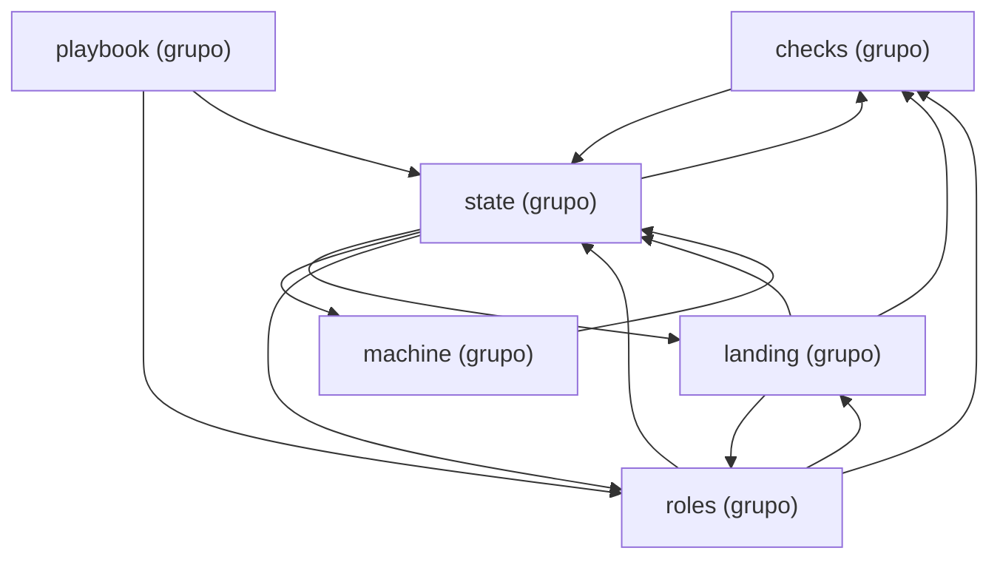

Esta página muestra los grupos de módulos de `domain` y una flecha por cada grupo que importa módulos de otro; cada nodo `<nombre> (grupo)` tiene su página. Los imports hacia otros paquetes se leen en la página de cada grupo, y los grupos se definen en `CLUSTERS`, en `scripts/docs/groups.py`.

- Padre: [Paquetes de process](packages-process.md)
- Hermanas:
  - [adapters.claude_sdk](packages-process-adapters-claude_sdk.md)
  - [adapters.filesystem](packages-process-adapters-filesystem.md)
  - [adapters.git](packages-process-adapters-git.md)
  - [adapters.github](packages-process-adapters-github.md)
  - [adapters.langgraph](packages-process-adapters-langgraph.md)
  - [adapters.shell](packages-process-adapters-shell.md)
  - [adapters](packages-process-adapters.md)
  - [application](packages-process-application.md)
- Grupos:
  - [domain: checks](packages-process-domain-checks.md)
  - [domain: landing](packages-process-domain-landing.md)
  - [domain: machine](packages-process-domain-machine.md)
  - [domain: playbook](packages-process-domain-playbook.md)
  - [domain: roles](packages-process-domain-roles.md)
  - [domain: state](packages-process-domain-state.md)

