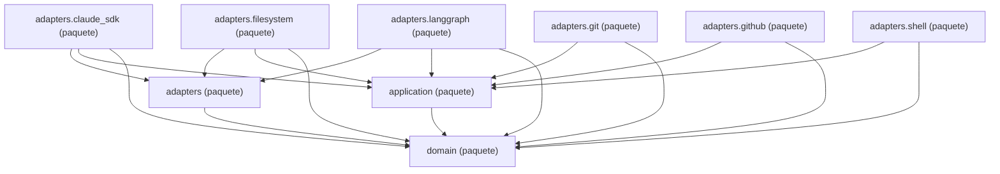

Esta página muestra los paquetes de `agentic.core.process`: `domain`, `application`, `adapters` y cada tipo de adaptador, con una flecha por cada paquete que importa a otro. Cada página dibuja los imports que hacen sus módulos, no quién los importa: las flechas que llegan a un paquete se leen en la página del paquete que importa.

- Páginas:
  - [domain](packages-process-domain.md)
    - [domain: checks](packages-process-domain-checks.md)
    - [domain: landing](packages-process-domain-landing.md)
    - [domain: machine](packages-process-domain-machine.md)
    - [domain: playbook](packages-process-domain-playbook.md)
    - [domain: roles](packages-process-domain-roles.md)
    - [domain: state](packages-process-domain-state.md)
  - [application](packages-process-application.md)
    - [application: build (parte 1)](packages-process-application-build-1.md)
    - [application: build (parte 2)](packages-process-application-build-2.md)
    - [application: checks](packages-process-application-checks.md)
    - [application: definition (parte 1)](packages-process-application-definition-1.md)
    - [application: definition (parte 2)](packages-process-application-definition-2.md)
    - [application: landing (parte 1)](packages-process-application-landing-1.md)
    - [application: landing (parte 2)](packages-process-application-landing-2.md)
    - [application: lifecycle (parte 1)](packages-process-application-lifecycle-1.md)
    - [application: lifecycle (parte 2)](packages-process-application-lifecycle-2.md)
    - [application: reflection](packages-process-application-reflection.md)
    - [application: support](packages-process-application-support.md)
  - [adapters](packages-process-adapters.md)
  - [adapters.claude_sdk](packages-process-adapters-claude_sdk.md)
  - [adapters.filesystem](packages-process-adapters-filesystem.md)
  - [adapters.git](packages-process-adapters-git.md)
  - [adapters.github](packages-process-adapters-github.md)
  - [adapters.langgraph](packages-process-adapters-langgraph.md)
  - [adapters.shell](packages-process-adapters-shell.md)

