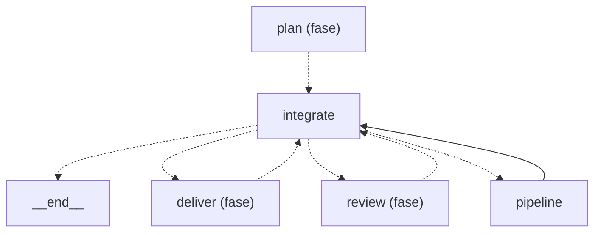
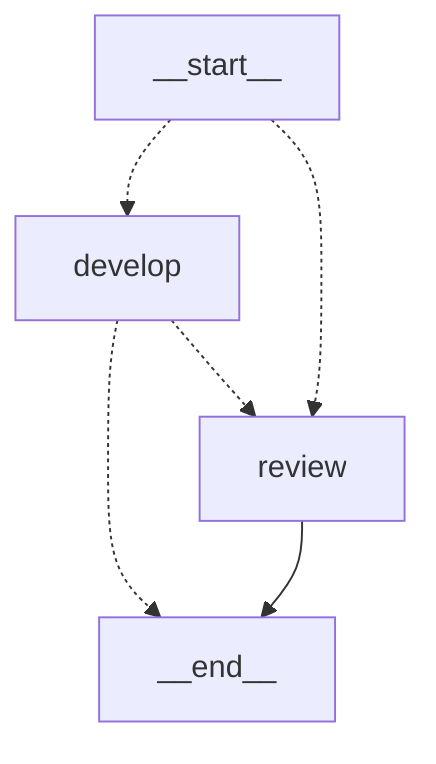

Esta página muestra los nodos de la fase `build` del grafo de roles y las aristas que la unen con otras fases; un nodo `<fase> (fase)` es otra fase, que se detalla en su página. Una flecha punteada es una arista condicional y una llena es fija.

- Padre: [Grafo de roles](role-graph.md)
- Hermanas:
  - [classify](role-graph-classify.md)
  - [define](role-graph-define.md)
  - [deliver](role-graph-deliver.md)
  - [Escalado y reanudación](role-graph-escalation.md)
  - [land](role-graph-land.md)
  - [plan](role-graph-plan.md)
  - [review](role-graph-review.md)

Pueden escalar: `integrate`

## Rama `pipeline`

El nodo `pipeline` corre, por cada subtarea, este grafo propio (`agentic.core.process.adapters.langgraph.graph:pipeline_branch`), que el grafo de arriba no expande.

