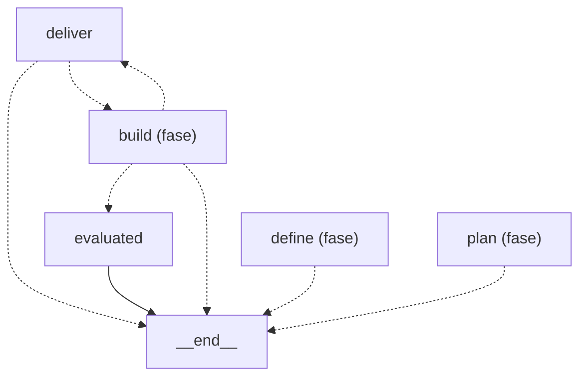

Esta página muestra los nodos de la fase `deliver` del grafo de roles y las aristas que la unen con otras fases; un nodo `<fase> (fase)` es otra fase, que se detalla en su página. Una flecha punteada es una arista condicional y una llena es fija.

- Padre: [Grafo de roles](role-graph.md)
- Hermanas:
  - [build](role-graph-build.md)
  - [classify](role-graph-classify.md)
  - [define](role-graph-define.md)
  - [design](role-graph-design.md)
  - [Escalado y reanudación](role-graph-escalation.md)
  - [land](role-graph-land.md)
  - [plan](role-graph-plan.md)

Pueden escalar: `deliver`
