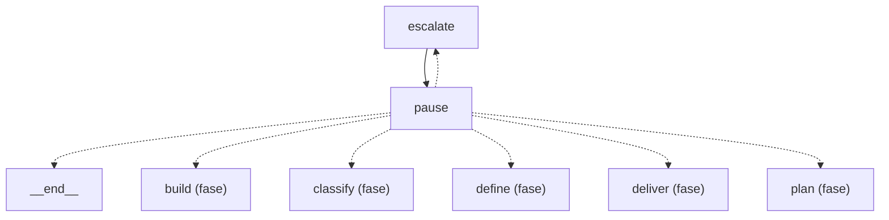

Esta página muestra el escalado y la reanudación: los nodos `escalate` y `pause` del grafo de roles y a qué fase vuelve el grafo cuando `pause` reanuda, una flecha por fase. Una flecha punteada es una arista condicional y una llena es fija.

- Padre: [Grafo de roles](role-graph.md)
- Hermanas:
  - [build](role-graph-build.md)
  - [classify](role-graph-classify.md)
  - [define](role-graph-define.md)
  - [deliver](role-graph-deliver.md)
  - [land](role-graph-land.md)
  - [plan](role-graph-plan.md)
  - [review](role-graph-review.md)

