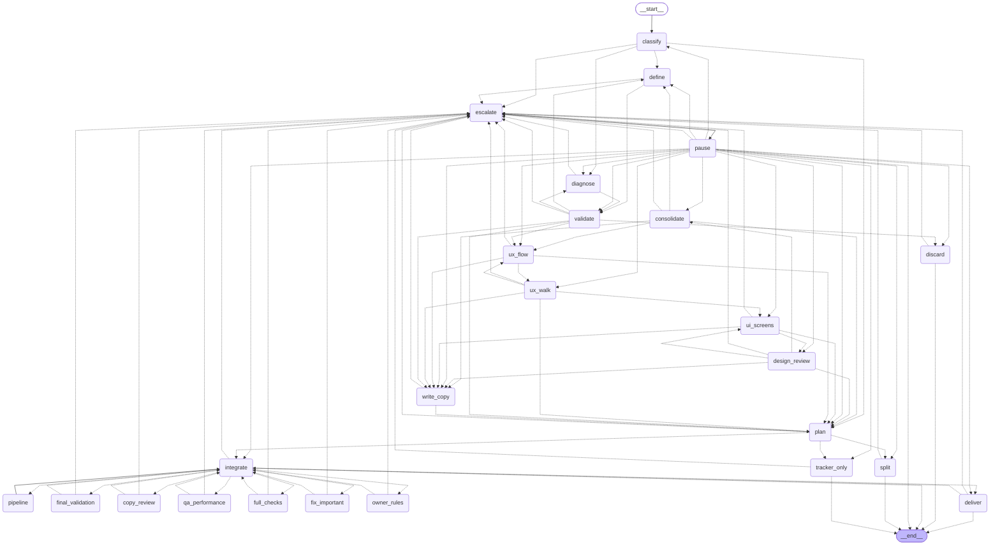
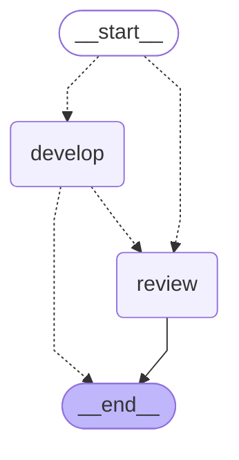

# Grafo de roles

Generado por `scripts/docs/generate.py` desde `agentic.composition:graph` (`get_graph(xray=True).draw_mermaid()`). No se edita a mano.

## Rama `pipeline`

El nodo `pipeline` corre, por cada subtarea, este grafo propio (`agentic.core.process.adapters.langgraph.graph:pipeline_branch`), que el grafo de arriba no expande.

