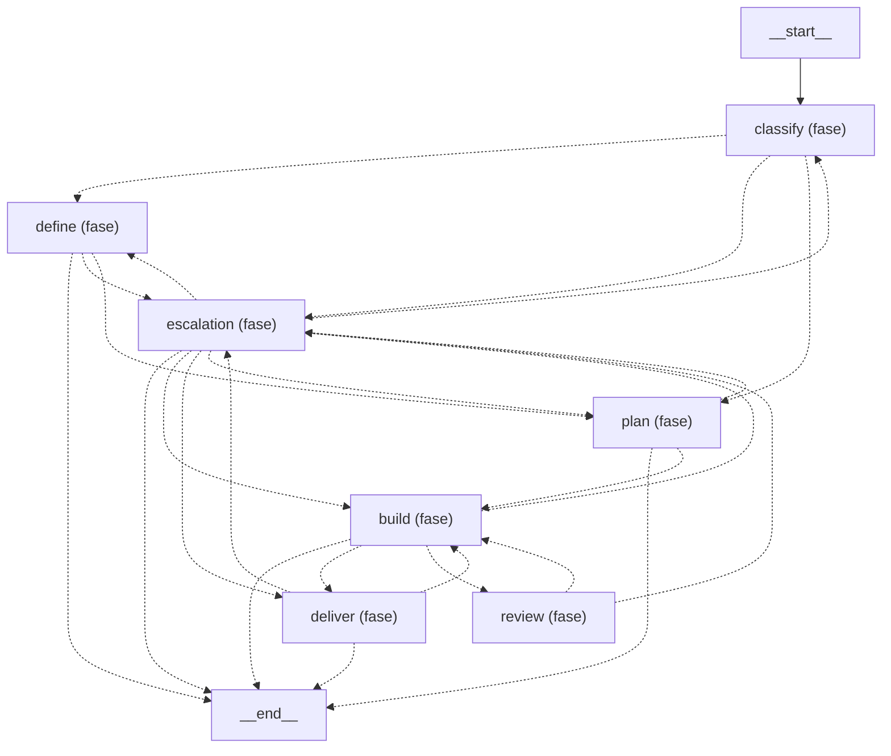

Esta página muestra el grafo de roles de `agentic.composition:graph` reducido a sus fases: cada fase es un nodo y cada flecha resume las aristas entre dos fases. Una flecha punteada es una arista condicional y una llena es fija. Generada por `scripts/docs/generate.py`; no se edita a mano.

- Fases:
  - [build](role-graph-build.md)
  - [classify](role-graph-classify.md)
  - [define](role-graph-define.md)
  - [deliver](role-graph-deliver.md)
  - [Escalado y reanudación](role-graph-escalation.md)
  - [land](role-graph-land.md)
  - [plan](role-graph-plan.md)
  - [review](role-graph-review.md)

